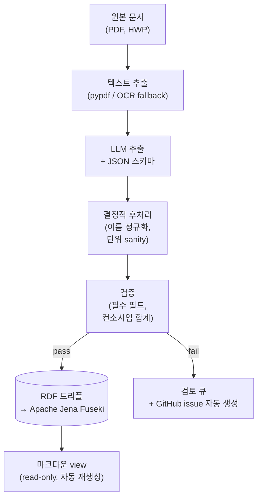
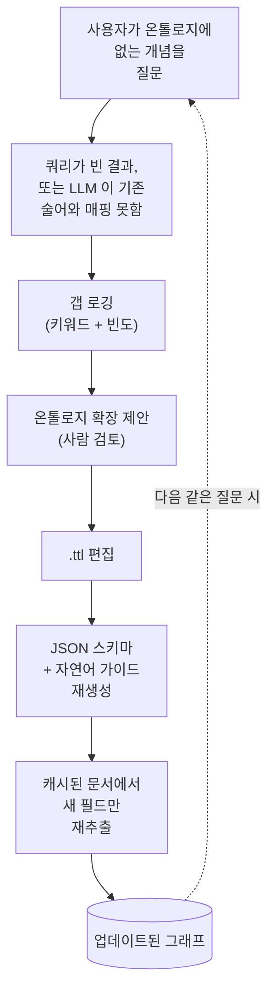

  

[이틀 전](), 오후
한나절을 들여 개인용 지식 베이스를 마크다운으로 하나 만들었다. 폴더, 슬러그,
프론트매터에 어디에 무엇을 둘지 정해 주는 작은 스킬까지. 시작치고는 괜찮았다. 그날
저녁쯤에는 페이지를 서로 연결해서 보는 것도 제법 쓸모가 있을 정도가 됐다.

문제는 그다음 날 생겼다. KB 에 정말 궁금한 걸 묻기 시작하니 금세 바닥이
드러났다. "이 기관이 지원한 과제만 모아서 보여줘." "이 사람이랑 같이 그 나라
다녀온 적 있었지, 그게 언제고 그때 무슨 과제였더라?" "올해 수행 중인 과제에서
우리 분담금 합계가 얼마지?" 관계형 DB 였으면 SQL 두 줄로 끝날 질문인데, 나는
마크다운 파일 더미를 들고 있었다. 그래서 오늘은 그 KB 를 이런 질문에 답할 수
있는 형태로 옮기는 데 하루를 썼다. 이번에도 재미있었던 건 코드를 치는 일보다
무언가를 결정하는 일 쪽이었다.

본론에 앞서 한 가지. 개인 KB 로 시작한 이 일은 문제를 하나씩 제대로 풀다 보니
어느새 작은 운영 시스템에 가까운 무언가가 되어 있었다. 추출 파이프라인이 있고,
그래프 저장소가 있고, MCP 서버가 있고, GitHub issue 큐가 있고, 스키마가 스스로
진화한다. 겉으로는 여전히 "메모 좀 쓰고 있어요" 처럼 보일 수 있지만, 안에서
돌아가는 방식은 달라졌다. 솔직히 말하면, KB 가 들어오는 질문에 제대로 답하려고
하면 결국 이렇게 흘러간다는 걸 이번에 알게 됐다.

## 그래프로 옮기는 이유

마크다운 KB 의 장점은 단순하고 투명하다는 점이다. 사람이 쓰고, 사람이 읽고,
에디터 하나면 끝난다. KB 를 지식 그래프로 옮기자는 쪽의 논리는 그 반대편에 있다.
개수, 조인, 범위, 집계처럼 구조화된 답이 필요한 순간 마크다운은 맞지 않는
도구라는 것이다. 결국 정규식으로 grep 하거나, 프론트매터에서 필드를 뽑는 작은
파서를 직접 짜게 되는데, 그쯤 되면 임시 쿼리 레이어를 손으로 만들고 있는 셈이다.
그래프는 그 쿼리 레이어를 처음부터 갖추고 있고, 제대로 된 질의 언어까지 딸려 온다.

그래서 오늘 목표는 단순했다. 마크다운은 그대로 둔다. Obsidian 에서 읽는 그
파일들은 계속 살려 두고 싶었다. 다만 그 밑에 두 번째 표현을 하나 더 깐다. 같은
콘텐츠로 그대로 되돌릴 수 있는 RDF 그래프를
[Apache Jena Fuseki](https://jena.apache.org/documentation/fuseki2/) 에 올리고,
나든, MCP 서버로 연결한 어떤 어시스턴트든 거기에 SPARQL 질의를 던질 수 있게 하는
것이다.

## 아키텍처 결정 사항

### 1. SoT 선택: 마크다운과 온톨로지

처음에는 마크다운을 SoT 로 두고 그래프는 거기서 뽑아낸 파생물로 다루려 했다.
그게 일이 제일 적으니까. 마크다운은 이미 있고, 프론트매터 규칙도 있고, 작은
스크립트 하나면 트리플로 풀어낼 수 있다.

그런데 그게 잘 안 됐다. 변환 스크립트 자체가 문제는 아니었다. 진짜 문제는
프론트매터가 결국 "그날 그 사람이 적고 싶었던 대로" 적혀 있다는 점이었다. 첫날
보니 `role` 필드가 빈 문자열인 과제가 셋, "주관" 으로 적힌 과제가 또 셋이었다.
스크립트는 양쪽을 다 존중하려 했고, 그 결과 같은 기관이 같은 과제의 주관이면서
동시에 일반 멤버라고 주장하는 트리플이 만들어졌다. 그래프는 이 모순을 막을 이유가
없으니 그대로 받아들였다. 이후의 정리 작업도 대부분 비슷한 양상이었다. 마크다운은
SoT 로 쓰기엔 너무 느슨했고, 그래프는 그 느슨함을 그대로 물려받았다.

그래서 결국 뒤집기로 했다. 질의 레이어의 SoT 는 온톨로지로 둔다. 그 온톨로지를
추출해 낸 원본 문서, 그러니까 PDF 나 HWP, 스프레드시트가 그보다 위의 SoT 다.
마크다운은 사람이 읽는 용도의 read-only view 로 내려간다. 사실이 바뀌어야 하면
문서나 그래프에서 바꾼다. 마크다운은 그 두 곳의 하류일 뿐이다.

이렇게 적어 놓으면 좀 차갑게 들리지만, 막상 적용해 보면 한 종류의 버그가 통째로
사라진다. 같은 기관 이름이 두 가지 표기로 그래프에 들어갈 일이 없다. 그래프를
만드는 코드가 `clean_org_name()` 을 정확히 한 번 부르고 끝나니까. 어느 기관이
어느 과제를 지원했는지 사람이 일관성 없이 입력할 여지도 없다. 그 필드는 애초에
평문으로 존재한 적이 없으니까.

### 2. "문서의 특성"의 의미와 기록 위치

여기서 두 레이어의 표현력 차이가 드러나는데, 한 번 짚고 넘어가고 싶다. 마크다운
프론트매터도, OWL 온톨로지도 "과제의 특성" 을 담을 수는 있다. 다만 담는 방식이
다르다.

프론트매터는 key 와 value 가 1:1 로 붙는 단순한 구조다. 과제 페이지에 `keti_pi`
는 이름 하나, `consortium` 은 리스트 하나, `budget` 은 숫자 하나가 들어간다.
여기까지는 괜찮다. 어색해지는 건 적고 싶은 _관계_ 가 자기 속성을 갖고 있을 때다.
컨소시엄 멤버십이 좋은 예다. "기관 X 가 컨소시엄에 있다" 가 아니라 "기관 X 가
역할 Y 로 컨소시엄에 있고, 그쪽 책임자는 인물 Z 고, 분담 예산은 W 원이다." 이걸
프론트매터에 담으려면 결국 `consortium: [{name, role, pi, share}, …]` 같은
모양이 된다. 이미 반쯤은 구조화된 데이터인 셈인데, YAML 파서는 이 형식을 강제하지
못하고, 다음에 그 파일을 고치는 사람은 슬그머니 다르게 적기 시작한다.

온톨로지는 같은 사실을 작은 그래프로 표현한다. Project 노드가 있고, 거기에
`hasConsortiumMembership` 으로 ConsortiumMembership 노드가 붙고, 그 Membership
노드가 자기 `memberOrg`, `memberRole`, `memberPI`, `memberBudgetShare` 를
가진다. 이를 reification 이라고 부른다. 관계 자체를 하나의 개체로 끌어올리는
방식이다. 단순 key-value 로는 얻을 수 없는 표현력을 이 방식이 준다. 대가는 문법이
다소 장황해진다는 점이고, 얻는 것은 "기관 X 가 지원한 모든 과제에서 컨소시엄 PI
로 등장한 기관이 어디인가" 같은 질문을 조인 로직을 직접 짜지 않고도 던질 수 있다는
점이다.

기준을 하나 정했다. 관계가 자기 속성을 갖고 있으면 온톨로지에 넣는다. 한 엔티티의
순수 속성, 그러니까 이름이나 날짜, 단일 숫자 같은 건 어디든 편한 쪽에 넣으면
되고, 그건 프론트매터로 충분하다.

### 3. 문서에서 그래프 추출

짧게 말하면, LLM 에게 스키마와 함께 던지면 된다. 어려운 일은 스키마가 대부분
맡는다. 요즘 LLM 은 JSON 스키마와 문서를 같이 받으면 꽤 충실하게 채워 준다.
다만 스키마는 올바른 값을 담을 만큼 표현력이 있고, 잘못된 값을 걸러 낼 만큼
엄격할 필요가 있다. 오늘 시간 대부분은 프롬프트가 아니라 스키마에 들어갔다.

최종적으로 쓰게 된 파이프라인은 다음과 같다.

<small><em>드래그로 이동, 스크롤로 확대</em></small>

LLM 뒤에 오는 두 박스가 핵심이다. LLM 은 그럴듯한 실수를 한다. 후처리 규칙과
검증기는 그 실수가 그래프에 들어가기 전에 잡아내는 역할을 한다. 검토 큐는 둘 다
못 잡은 경우의 비상구다. 그렇게 넘어온 케이스는 작은 GitHub issue 로 등록되고,
내가 직접 봐야 할 건 그 정도다.

### 4. 로컬 모델과 상용 모델

둘 다 써 봤다. 제약은 분명했다. [Claude](https://claude.ai) 는 정액제 Pro
요금제로 쓰고 있는데, Anthropic API 는 이와 별도로 사용량만큼 과금된다. 개인
프로젝트에 사용량 요금이 쌓이는 건 원치 않았다. 그래서 가장 정확한 옵션이라는 걸
알면서도, Anthropic API 를 기본 추출기로 쓰는 안은 일찍 제외했다. 정말 중요한
문서 몇 건에만 가끔 쓰는 용도로 남겨 두었다.

기본은 로컬일 수밖에 없었다. 다행히 메모리가 넉넉한 머신이 있고
[Ollama](https://ollama.com) 도 이미 깔려 있었다. 그러면 남는 질문은 어느 로컬
모델을 쓰느냐였다.

로컬 모델에는 잘 언급되지 않는 비용이 있다. 좋은 로컬 모델도 상용 frontier
모델보다 결과의 편차가 크다. 호출 한 번이 더 오래 걸린다. 가끔은 상용 모델이라면
하지 않을 방식으로 스키마를 어긴다. 그래도 호출당 비용이 0 이라는 점 하나로 이런
단점을 감수할 만하다. 일상적인 케이스에는 그 정도면 충분하다.

### 5. 온톨로지 관리 주체

하루에 스키마를 세 번째 고치고 나서야 진지하게 고민하게 된 질문이다.
온톨로지는 `.ttl` 파일이다. LLM 추출기는 거기 정의된 속성을 알고 있어야 한다.
모르면 추출이 안 된다. MCP 서버 뒤에 있는 자연어→SPARQL 헬퍼도 마찬가지다.
모르면 없는 이름을 지어낸다(환각). 결국 속성 하나를 추가할 때마다 세 군데를
고치고 있었다. 온톨로지 파일, 추출기가 쓰는 JSON 스키마, 쿼리 헬퍼가 읽는
자연어 가이드.

세 번째 수정을 마치고 작은 생성기를 짰다. 이제 `.ttl` 파일이 내가 손대는 유일한
곳이고, JSON 스키마와 자연어 가이드는 거기서 자동으로 만들어진다. 쿼리 헬퍼는
매 호출마다 자연어 가이드를 다시 읽도록 해 두었다. 그래서 어휘를 바꿔도 MCP 서버를
재시작할 필요가 없다. 다음 할 일은 추출기 스키마까지 같은 방식으로 만드는 것이다.
그렇게 되면 온톨로지가 진짜로 유일한 원본이 되고, 나머지는 모두 거기서 파생된다.

조금 일반화하면, 세 군데를 손으로 맞춰야 하는 온톨로지는 결국 어긋나기 마련이다.
오래 유지하려면 정본 표현 하나를 두고, 나머지는 거기서 빌드해 만드는 단계를 두는
것이 바람직하다.

## 모델 비교

"로컬 모델도 쓸 만하다" 는 말을 근거 없이 하기는 좀 그래서, 실제로 비교를 한 번
돌려 봤다. 한국어로 된 긴 기술 문서 한 건(본문 약 23,000 자)에서 뽑아야 할
메타데이터는 식별자, 기간, 예산, 다기관 컨소시엄, 역할 배정이다. 같은 입력을 세
추출기로 돌리고 필드별로 채점했다.

세 추출기는 다음과 같다.

- **Claude (세션 내)**: 평소 쓰는 Anthropic 모델에 문서를 API 가 아니라 대화
  안에서 직접 넘긴 경우. 비용이 Pro 구독료에 포함돼 있어 따로 과금되지는 않는다.
  다만 대화형이라 파이프라인 부품으로 쓰기에는 적합하지 않다.
- **`qwen2.5:32b` (로컬, Ollama)**: Alibaba 가 만든 320 억 파라미터 모델.
  한국어를 잘 다루고 strict JSON 출력 형식도 잘 지킨다. Q4_K_M 양자화, 로컬
  데몬으로 서빙.
- **`exaone3.5:32b` (로컬, Ollama)**: LG AI Research 가 만든 320 억 파라미터
  모델. 한국어에 최적화돼 있다. 같은 양자화, 같은 서버.

스칼라 필드 15 개(식별자, 기간, 이름, 예산, 역할)와 구조화된 배열(컨소시엄,
연차별 예산)을 채점했다. 결과는 아래와 같다.

| 항목                         | Claude (세션) | `qwen2.5:32b` | `exaone3.5:32b`     |
| ---------------------------- | ------------- | ------------- | ------------------- |
| 기준값과 일치 (15개 중)      | 15            | 9             | 8                   |
| 잘못된 값                    | 0             | 1             | 3                   |
| 스키마 지시 엄격 준수        | 예            | 대체로        | 플래그 해제 후 가능 |
| Ollama 의 `format=json` 모드 | n/a           | 동작          | `{}` 만 반환        |
| 문서당 시간                  | 대화형        | 4 분 39 초    | 3 분 30 초          |
| 문서당 비용                  | Pro 구독 포함 | 0             | 0                   |
| 파이프라인 친화 (배치, 재현) | 아니오        | 예            | 예                  |

몇 가지가 눈에 띈다.

Claude 가 더 낫다. 다만 그 "더 낫다" 는 신중한 동료가 문서를 대신 읽어 주는
느낌에 가깝다. PDF 50 개를 큐에 넣고 돌릴 대상은 아니다.

`qwen2.5:32b` 는 배치 추출기로 충분히 쓸 만하다. 대표적인 실패가 좀 미묘한데,
다기관 컨소시엄에서 자기 자신, 그러니까 그 문서를 작성한 주체인 기관을 컨소시엄
파트너 중 하나로 끼워 넣는다. 결정적 후처리로 잡을 수 있는 종류다. alias 를
떼어 내고, 거기 묶여 있던 PI 를 다른 필드로 옮기면 된다. 이 후처리 코드 30 줄을
한 번 써 두면 그다음부터는 쓸 만하다. 그 외에는 거의 다 맞힌다.

`exaone3.5:32b` 는 의외였다. 서류상으로는 한국어에 특화된 모델인데, 실제로는
Ollama 의 strict `format=json` 모드에서 빈 객체만 돌려준다. 모든 필드가 null.
원인은 정확히 그 플래그 하나였다. strict-JSON 옵션을 끄고 시스템 프롬프트의
스키마만으로 읽게 하니 그제야 멀쩡한 출력이 나왔다. 그렇게 살린 뒤에도 `qwen`
보다 한 단계 더 심각한 실수가 남아 있었다. 두 군데에서 컨소시엄의 주관 기관을
통째로 빼먹었고, 한 군데에서는 통화 단위를 천 배 잘못 읽었다. 주관 기관을
빼먹는 건 `qwen` 의 실수와 정반대라 조금 재미있기도 하다. 단위 오류는 더 골치
아프다. 자릿수 검사를 따로 넣어 두지 않으면 이후 단계에서 아무도 잡아내지 못한다.

요약하면, 무인 파이프라인의 기본값으로는 strict JSON 을 깔끔하게 처리하고 실수
유형이 한 가지로 예측 가능한 작은 로컬 모델이 적당해 보인다. 비싸고 정확한 옵션은
첫 시도부터 맞혀야 하는 케이스에만 아껴 쓰는 편이 좋겠다.

## 스키마 진화 루프

가장 흥미로운 미해결 질문은, 온톨로지가 아직 모델링하지 않은 개념에 대한 질문이
들어왔을 때 어떻게 해야 하느냐다. 예를 들어 쿼리 헬퍼에게 "사업화 계획이 있는
과제를 보여줘" 라고 묻는다고 하자. 온톨로지에는 `commercializationPlan` 같은
속성이 없다. 헬퍼가 만든 SPARQL 은 빈 결과를 돌려준다. 결과를 본 나는 KB 에
뭔가 빠져 있다고 판단한다. 그다음에는 그냥 넘어가거나, 더 나은 방법으로는
온톨로지를 확장해 속성을 추가한 뒤 기존 문서를 다시 추출한다.

이 두 번째 방법이 스키마 진화 루프다. 정적인 그래프를 살아 움직이게 만드는
메커니즘이다.

여기서 까다로운 부분은 크게 세 가지로 볼 수 있다. 첫째, 질문이 _진짜 갭_ 을
찌른 건지, 아니면 기존 스키마에서 데이터가 비어 있는 영역을 찌른 건지 가려내는
일. 휴리스틱으로는 헬퍼가 만든 SPARQL 에 없는 술어가 있는지 보거나, 결과가
비었을 때 질문의 키워드가 기존 술어의 라벨 중 어느 것과도 매칭되지 않는지 살피는
방법이 있다. 둘째, 확장을 _책임지고_ 제안하는 일. LLM 이 키워드만 보고 그럴듯한
클래스나 속성을 제안할 수는 있지만, 큐레이션 없이 자라는 온톨로지는 어느 순간
일관성을 잃는다. 그래서 사람의 확인이 필요하다. 셋째, _새 것만 다시 뽑아 오는_
일. 스키마가 바뀔 때마다 전체 문서를 다시 추출하면 비용을 감당할 수 없다. 그래서
캐시 키는 `(문서)` 가 아니라 `(문서, 필드)` 로 잡을 필요가 있다.

아이디어 자체는 새롭지 않다. 드문 건 이를 평소 작업 흐름에 실제로 녹여 넣을
만큼 진지하게 다루는 경우다. 확장 비용이 충분히 낮게 유지된다면, 내가 실제로
던지는 질문이 온톨로지를 키워 나가기를 기대하고 있다. 머릿속에서 미리 상상한
질문이 아니라, 실제로 던져진 질문이 다음 스키마를 이끌어 가도록.

## 운영 방식: terminate-on-failure

초기에 정한 원칙 하나는 적어 두고 싶다. 파이프라인이 특정 검증 실패에서 그냥
넘어가지 않고 멈추도록 했다. 추출기가 평균보다 두 자릿수 작은 예산을 내놓으면
파이프라인은 그 잘못된 숫자를 조용히 저장하지 않는다. 대신 검토 폴더에 작은
JSON 하나를 쓰고, 문제 문서의 슬러그와 어떤 검증이 깨졌는지 담아 GitHub issue
를 열고, 거기서 멈춘다. 그래프는 마지막으로 멀쩡했던 상태 그대로 남는다.

처음 며칠은 좀 갑갑했다. 검증기가 필요 이상으로 빡빡해서 가끔 풀어 줘야 했다.
그런데 이 방식이 LLM 기반 파이프라인의 최악의 실패를 막아 준다. 최악의 실패란
그럴듯해 보이지만 사실은 틀린 데이터가 조금씩 쌓이다가, 집계 쿼리가 살짝 어긋난
답을 내놓고 나서야 알아차리는 상황이다. 애매하지만 명백히 틀렸다고 하기도 어려운
데이터는 데이터가 없는 것보다 오히려 나쁘다. 시스템 전체에 대한 신뢰를 깎아 먹기
때문이다.

운영 방식은 한 줄로 정리할 수 있다. 파이프라인은 추측하지 않고, 결정할 수 없을
때는 묻는다. 그 묻는 수단이 issue 다. 덤으로 온전한 감사 로그도 된다. 데이터의
이상 케이스가 모두 closed 또는 open issue 로 남고, closing comment 에는 내가
어떤 결정을 했는지가 기록된다.

LLM 기반 시스템에서는 이쪽이 적절한 기본값이라고 생각한다. 처리량을 우선하면
조용한 fallback 쪽으로 흐르고, 신뢰를 우선하면 시끄러운 실패 쪽으로 가게 된다.

## 정리

해 보기 전과 생각이 달라진 점이 몇 가지 있다.

온톨로지는 작아도 괜찮다. 클래스 10 개, 속성 44 개. 스키마 진화 루프가 요구하는
만큼 늘리면 되고, 빌드 단계가 있어서 늘리는 비용도 별로 들지 않는다. "처음부터 다
모델링하자" 는 욕심 때문에 지금까지 흐지부지된 KB 가 셀 수 없이 많다.

한국어 자체가 의외로 까다로웠다. 오늘 애먹은 문제 가운데 세 가지가 한국어 특유의
것이었다. 초기 SPARQL 쿼리의 절반을 깨뜨린 문자열 리터럴의 언어 태그(`@ko`),
어떤 곳은 `㈜` 가 붙고 어떤 곳은 안 붙는 기관명 정규화, 그리고 enum 에 깜빡하고
넣지 않은 값("신청중"). 어느 것도 근본적인 문제는 아니었지만, 계획에 없던
하루치 디버깅 시간이 들었다.

개인 KB 가 운영 시스템 쪽으로 흘러간 건 분명하다. 개인 지식 베이스로 시작했는데
어느새 작은 운영 시스템에 가까워졌다. 나쁘다고 보지는 않는다. "메모를 잘
쓰자" 가 아니라 "내가 유일한 사용자인 작은 내부 도구를 만들자" 라고 인정하면
되는 일이다.

다음 단계는 대략 이렇게 생각하고 있다. 자연어 쿼리 헬퍼가 갭을 능동적으로
알아채도록 스키마 진화 루프를 마무리한다. 파이프라인 입력을 폴더 감시 방식으로
바꿔, 클라우드 폴더에 PDF 를 넣는 것 말고는 내가 할 일이 없도록 만든다. 자동으로
재생성된 마크다운 view 를 신뢰할 수 있게 되면, 손으로 쓴 마크다운 파일들은
거기에 자리를 내준다.

이번에도 가장 궁금한 건, 이 변화가 내가 KB 에 _묻는_ 질문의 결을 바꾸느냐다.
마크다운 KB 에서 내 질문은 거의 "X 에 관한 파일 찾아줘" 모양이었다. Fuseki 위의
그래프에서는 "세어줘", "평균 내줘", "두 가지가 겹치는 데 보여줘" 가 될 수
있다. 쓸모의 결이 다르다. 그게 내가 정말 원했던 종류인지는 일주일쯤 지나면 알게
될 것 같다.
