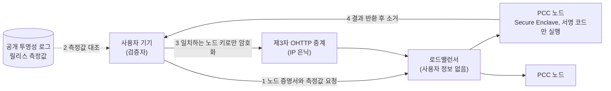

<small><em>English version: <a href="{{ '/blog/2026/confidential-computing-tee-vs-pcc/' | relative_url }}">Confidential Computing: TEE vs. PCC, Component vs. System</a></em></small>



AI 서비스가 메일 요약처럼 개인의 데이터를 직접 다루는 일이 늘면서, 그 데이터가 서버에서 어떻게 지켜지는지도 함께 궁금해지는데요, [지난 글]({{ '/blog/ko/trusted-execution-environments/' | relative_url }})에서는 TEE 안에서 AI 모델을 돌리는 이야기를 했습니다. 엔클레이브 메모리가 작고, 신뢰가 CPU에 갇혀 있고, CPU와 GPU 사이 암호화 전송이 비싸다는, 주로 하드웨어 쪽 이야기였죠. 다만 이번에는 시선을 한 단계 위로 올려 보려고 합니다. TEE라는 부품이 있다고 해서 사용자가 믿을 수 있는 AI 서비스가 만들어지는 걸까요?

이 질문을 꺼낸 계기는 [Apple Private Cloud Compute(PCC)](https://security.apple.com/blog/private-cloud-compute/)입니다. PCC는 흔히 "Apple이 만든 기밀 컴퓨팅"으로 소개되는데요, 들여다보면 TEE와 같은 층위의 기술은 아닌 것 같아요. TEE는 프로세서가 제공하는 격리 공간이고, PCC는 그 격리 공간을 바닥에 깔고 그 위에 여러 장치를 쌓아 올린 서비스 설계입니다. 그래서 "TEE vs PCC"는 어느 쪽이 더 나은지를 겨루는 비교라기보다, 부품과 시스템 사이에 무엇이 비어 있고 PCC가 그 사이를 어떻게 메웠는지를 보는 비교에 가깝다고 생각합니다.

## 기밀 컴퓨팅을 다시 짚어 보기

기밀 컴퓨팅 컨소시엄(CCC)은 기밀 컴퓨팅을 '하드웨어 기반의, 증명된 TEE 안에서 계산을 수행해 사용 중인 데이터를 보호하는 것'으로 정의합니다.[^ccc] 여기서 눈여겨볼 말은 '증명된(attested)'입니다. 격리만으로는 부족하고, 그 격리를 밖에서 확인할 수 있어야 한다는 뜻이겠죠.

동작은 대략 이렇게 흘러가는데요, CPU가 격리 공간을 만들고, 메모리 컨트롤러가 그 공간의 메모리를 TEE별 키로 암호화합니다. TEE가 뜰 때 올라간 펌웨어와 커널, 애플리케이션의 해시를 하드웨어가 측정하고, 칩 고유 키로 서명한 증명 보고서를 만듭니다. 데이터 주인은 이 보고서를 검증한 뒤에야 복호화 키를 넘기구요. 정리하면 격리와 암호화는 '못 보게' 막는 장치이고, 원격 증명은 '믿어도 되는지' 확인하는 장치인 셈이에요.

여기까지는 익숙한 이야기일 것 같아요. 그런데 이 흐름에는 잘 드러나지 않는 전제가 하나 있습니다. **누가 증명을 검증하는가**, 그리고 **검증하는 쪽이 무엇을 기준으로 '정상'을 판단하는가**입니다. PCC와 일반 클라우드 기밀 컴퓨팅의 차이는 대부분 이 전제에서 갈린다고 봅니다. 그럼 지금의 클라우드 기밀 컴퓨팅은 어디까지 지켜 줄까요?

## 클라우드 기밀 컴퓨팅이 지키는 범위

주요 클라우드 3사는 모두 CPU TEE 기반 기밀 VM을 정식 서비스로 제공합니다. Azure와 Google Cloud는 AMD SEV-SNP와 Intel TDX에 자체 증명 서비스를 붙였고, GPU까지 TEE로 묶은 상품도 Azure(H100, 2024년 9월 GA)와 Google Cloud(H100 2025년 7월 GA, Blackwell 기반 RTX PRO 6000 2026년 8월 GA)에서 나와 있습니다.[^gcp] AWS는 결이 조금 다른데요, Nitro 시스템에 운영자가 고객 데이터에 접근할 수단 자체를 두지 않는 설계를 내세우고, 이를 약관과 NCC Group의 독립 검토로 뒷받침합니다.[^nitro]

이 서비스들의 신뢰 모델은 비교적 분명한 편입니다. 믿지 않는 대상은 클라우드 운영자, 하이퍼바이저, 호스트 관리 소프트웨어, 옆 테넌트입니다. 믿는 대상은 CPU와 GPU 벤더의 하드웨어, 펌웨어, 인증서 체계입니다. 물리 공격은 대체로 위협 모델 밖에 있구요. 1,000달러가 안 되는 DDR5 메모리 버스 인터포저로 SGX, TDX, SEV-SNP의 증명 키를 빼낸 TEE.fail이 2025년 10월에 공개됐을 때도 AMD와 Intel은 물리 공격은 범위 밖이라는 입장을 유지했습니다.[^teefail]

그리고 가장 중요하다고 생각하는 점이 있습니다. 클라우드 기밀 컴퓨팅에서 **증명을 검증하고 키를 넘기는 쪽은 테넌트, 즉 서비스를 운영하는 고객 자신**입니다. 테넌트는 자기 코드를 믿고, 클라우드 사업자를 믿지 않습니다. 이 구도는 은행이 자기 거래 데이터를 클라우드에서 처리하거나, 병원들이 서로의 데이터를 내놓지 않고 공동 모델을 학습시키는 경우에는 잘 들어맞습니다. 데이터 주인이 곧 검증자이기 때문이죠.

## 서비스 운영자까지 믿지 않으려면

다만 개인 AI 서비스로 오면 구도가 달라집니다. 제가 휴대폰에서 AI에게 메일 요약을 부탁하면, 그 요청은 서비스 운영자의 서버로 갑니다. 이때 데이터 주인은 저이고, 서비스 운영자는 클라우드 기밀 컴퓨팅의 '테넌트' 자리에 앉아 있습니다. 클라우드 기밀 컴퓨팅은 운영자의 워크로드를 클라우드 사업자로부터 지켜 줄 수는 있지만, **사용자의 데이터를 운영자로부터 지켜 주지는 않습니다.** 운영자가 TEE 안에서 무엇을 돌리는지, 로그를 남기는지, 디버깅 셸을 열어 두었는지는 사용자가 확인할 길이 없거든요.

정리하면 TEE는 "이 하드웨어 위에서 이 해시의 코드가 돈다"까지를 보장합니다. 그 해시가 무엇을 하는 코드인지, 그 코드가 내 데이터를 남기지 않는지, 운영자가 장애 대응을 핑계로 들어갈 수 없는지는 TEE가 대답해 주지 않습니다. 그 부분은 시스템 설계가 채워야 하는 영역이라고 생각합니다. PCC는 바로 그 부분을 채우려는 시도로 볼 수 있을 것 같아요.

## Apple PCC가 TEE 위에 쌓은 것

Apple은 2024년 6월 PCC를 공개하면서 다섯 가지 요구사항을 내걸었습니다.[^pcc] 각 요구사항이 TEE만으로 얻을 수 있는 것과 PCC가 덧붙인 장치를 나란히 놓으면 차이가 잘 보이는데요, 표로 정리해 보았습니다.

| 요구사항              | TEE만으로 얻는 것              | PCC가 덧붙인 장치                                                                                     |
| --------------------- | ------------------------------ | ----------------------------------------------------------------------------------------------------- |
| 상태 없는 처리        | 메모리 암호화, 종료 시 키 폐기 | 범용 로깅 제거, 감사된 구조화 로그만 반출, 재부팅마다 데이터 볼륨 키 교체(암호학적 소거)              |
| 강제 가능한 보장      | 하드웨어 격리                  | TLS 종단 로드밸런서 같은 외부 구성 요소에 핵심 보호를 맡기지 않는 구조                                |
| 특권 런타임 접근 차단 | 하이퍼바이저와 호스트 OS 차단  | 원격 셸과 대화형 디버깅 제거, 개발자 모드 비활성, 승인된 서명 코드만 실행, JIT 차단                   |
| 표적 불가능성         | 해당 없음                      | 제3자 OHTTP 중계로 출발지 IP 은닉, 블라인드 서명 기반 일회용 자격증명, 노드 일부 집합에만 암호화 전송 |
| 검증 가능한 투명성    | 측정값 서명(증명 보고서)       | 모든 프로덕션 이미지 측정값을 추가 전용 투명성 로그에 공개, 연구자용 가상 환경(VRE) 공개, 바운티      |

몇 가지는 따로 짚어 둘 만한 것 같아요.

**검증자를 사용자 기기로 옮김**: PCC에서 증명을 검증하는 쪽은 Apple의 서버가 아니라 사용자의 기기입니다. 기기는 증명된 측정값이 공개 투명성 로그에 올라 있는 소프트웨어 릴리스와 일치하는 노드의 공개키에만 요청을 암호화해 보냅니다. 운영자가 몰래 다른 코드를 올리면, 그 코드는 로그에 없으므로 기기가 데이터를 보내지 않습니다. 운영자가 자기 자신을 신뢰 범위에서 빼는 구조에 가깝다고 봅니다.

**'정상'의 기준을 공개함**: 증명이 의미를 가지려면 측정값이 무엇을 뜻하는지 누군가 확인할 수 있어야 합니다. Apple은 프로덕션 빌드 이미지를 공개하고, Mac에서 PCC 노드 소프트웨어를 VM으로 띄워 볼 수 있는 VRE를 내놓았으며, PCC 원격 코드 실행에 최대 100만 달러의 바운티를 걸었습니다.[^pccresearch] 증명은 해시를 보여 줄 뿐이고, 그 해시를 믿을 이유는 투명성과 외부 검증이 만드는 셈이에요.

**특정 사용자만 노릴 수 없게 함**: 요청은 제3자가 운영하는 OHTTP 중계를 거쳐 출발지 IP가 가려집니다. 로드밸런서는 사용자 식별 정보를 갖지 않으므로 특정 사용자의 요청을 특정 노드로 몰 수 없구요. 노드 하나를 장악하더라도 원하는 사람의 데이터를 골라 볼 수 없게 만드는 장치입니다. TEE에는 이런 개념 자체가 없죠.

<small><em>그림 1. PCC 요청 흐름 단순화(Apple 공개 자료 기반), 드래그로 이동, 스크롤로 확대</em></small>

TEE와 PCC를 나란히 놓으면 다음과 같이 정리해 볼 수 있습니다.

| 구분           | 클라우드 TEE(기밀 VM, GPU TEE)             | Apple PCC                                 |
| -------------- | ------------------------------------------ | ----------------------------------------- |
| 층위           | 프로세서와 플랫폼이 제공하는 부품          | TEE 위에 쌓은 서비스 설계                 |
| 믿지 않는 대상 | 클라우드 사업자, 하이퍼바이저, 다른 테넌트 | 위 대상에 더해 서비스 운영자(Apple) 자신  |
| 증명 검증 주체 | 테넌트(서비스 운영자)                      | 최종 사용자의 기기                        |
| '정상' 기준    | 테넌트가 정한 기대 측정값                  | 공개 투명성 로그의 릴리스 측정값          |
| 운영자 접근    | 테넌트 설정에 좌우됨                       | 셸, 디버깅, 개발자 모드 제거              |
| 표적 공격 대응 | 범위 밖                                    | OHTTP 중계, 블라인드 서명, 노드 선택 감사 |
| 외부 검증      | 벤더 문서와 감사 보고서                    | 이미지 공개, VRE, 바운티                  |

## 2026년 6월: PCC가 범용 클라우드 TEE 위로

흥미로운 일은 올해 6월에 있었는데요, Apple은 PCC를 Google Cloud로 넓히면서 Intel TDX, NVIDIA Blackwell 기밀 GPU, Google Titan 칩을 조합했습니다.[^expand] 원래 PCC는 Apple 실리콘 서버와 Secure Enclave라는 자체 하드웨어를 바닥으로 삼았는데, 이제 그 바닥 일부를 누구나 빌려 쓸 수 있는 클라우드 기밀 컴퓨팅으로 바꾼 것입니다. 에이전트형 도구 사용이나 복잡한 추론처럼 가장 무거운 작업이 그 대상이구요.

이 확장에서 Apple이 내건 설계 원칙을 보면 TEE를 어떻게 바라보는지가 잘 드러나는 것 같아요.

- **복수 신뢰 루트**: 사용자 데이터 유출에 쓰일 수 있는 구성 요소는 서로 다른 벤더의 독립된 신뢰 루트 2개 이상에 뿌리를 둔 증명을 요구함
- **하드웨어 원장 관리**: PCC에 속한 Google Cloud 하드웨어 전체를 암호학적으로 검증 가능한 추가 전용 원장으로 관리함
- **기밀 컴퓨팅에만 기대지 않음**: 펌웨어부터 호스트, 게스트 OS, 애플리케이션까지 모두 TCB로 취급하고, 부채널과 특권 접근 공격 방어를 기밀 컴퓨팅 하나에 맡기지 않음
- **원칙 유지**: 다섯 가지 요구사항은 그대로 유지함

TEE.fail 같은 물리 공격이 꾸준히 나오는 상황에서, 벤더 하나의 TEE를 무조건 믿는 대신 여러 벤더의 신뢰 루트를 겹치고 나머지는 시스템 설계로 메우겠다는 선택으로 읽힙니다. Signal이 서로 다른 TEE 세 종류에 비밀을 나눠 둔 것과도 같은 맥락이구요. 개인적으로는 TEE가 필요조건이지만 충분조건은 아니며, PCC는 그 차이를 공개적으로 인정한 설계라고 생각합니다.

같은 방향으로 수렴하는 서비스도 늘고 있습니다. Meta의 WhatsApp Private Processing(SEV-SNP와 H100, 제3자 중계, 제3자 로그 대조), Google의 Private AI Compute(기밀 VM과 TPU용 엔클레이브, IP 블라인딩 중계), 그리고 9월 DevDay에서 발표된 OpenAI Private Intelligence까지, 모두 **TEE와 원격 증명, 제3자 중계, 공개 로그**를 조합하는 구조를 택했습니다.[^meta][^google] 개인 AI 서비스에서는 이 조합이 현실적인 기본형으로 자리 잡아 가는 듯 합니다. 그럼 이 흐름을 산업 AI에는 어떻게 가져올 수 있을까요?

## 산업 AI에 주는 시사점

PCC는 소비자 서비스 사례지만, 산업 AI에도 옮겨 볼 만한 질문을 던진다고 봅니다. 제조 현장에서는 모델을 가진 장비 공급사와 데이터를 가진 공장처럼, 운영 주체와 데이터 주체가 다른 경우가 흔하죠. 이때 "TEE를 쓰니 안전하다"는 설명은 PCC 이전의 클라우드 기밀 컴퓨팅과 같은 한계를 가질 수 있습니다. 데이터 주인이 직접 검증할 수 없다면, 결국 운영자를 믿어 달라는 이야기로 돌아가기 때문입니다.

PCC에서 빌려 올 만한 설계 원칙은 다음 정도로 정리해 볼 수 있습니다.

- **흐름 단위의 설계**: 증명으로 환경을 확인하고, 그다음 키와 데이터를 넣고, 격리된 곳에서 실행하고, 허용된 결과만 내보내는 흐름 전체를 설계 단위로 보는 것이 바람직함
- **검증 주체의 위치**: 증명을 검증하는 쪽을 데이터 주인 가까이에 두는 것이 핵심임
- **측정값의 의미 공개**: 측정값을 해석할 수 있는 투명성 로그나 재현 가능 빌드가 없으면 증명은 '믿어 달라'는 주장에 머묾
- **복수 신뢰 루트**: 단일 벤더 TEE에 모든 것을 걸지 않고, 물리 보안과 시스템 하드닝을 함께 두는 다층 방어가 필요함

국내로 눈을 돌리면 아직 갈 길이 조금 있는 것 같아요. 국내 클라우드 사업자가 자체 인프라로 TEE 기반 상품을 공개 출시한 사례는 공개 자료에서 찾기 어렵고, KT의 시큐어 퍼블릭 클라우드는 Azure 기밀 컴퓨팅을 기반으로 합니다. 데이터 비반출형 협업이나 공공 AI 서비스를 생각한다면, 하드웨어 도입과 함께 국내에서 운영하는 증명 검증 체계와 투명성 인프라를 준비해 나가는 것도 의미가 있을 듯 합니다.

TEE가 하드웨어로 '못 보게' 만드는 기술이라면, PCC는 그 사실을 사용자가 '확인할 수 있게' 만드는 시스템에 가깝다고 생각합니다. 기밀 컴퓨팅의 다음 과제는 아마 칩보다 이 확인 가능성 쪽에 더 많이 남아 있을 것으로 보입니다. 다음 글에서는 방향을 반대로 돌려, 시스템 단위에서 쓰이던 제로 트러스트를 하드웨어 안쪽, 로봇 관절까지 끌고 내려가 보는 이야기를 해 보겠습니다.

## 참고 문헌

[^ccc]: Confidential Computing Consortium, [A Technical Analysis of Confidential Computing v1.3](https://confidentialcomputing.io/wp-content/uploads/sites/10/2023/03/CCC-A-Technical-Analysis-of-Confidential-Computing-v1.3_unlocked.pdf)

[^gcp]: Google Cloud, [Confidential VM release notes](https://docs.cloud.google.com/confidential-computing/confidential-vm/docs/release-notes); NVIDIA, [Azure confidential VM with H100 GA](https://blogs.nvidia.com/blog/azure-confidential-vm-h100-general-availability)

[^nitro]: AWS, [The Security Design of the AWS Nitro System: No AWS operator access](https://docs.aws.amazon.com/whitepapers/latest/security-design-of-aws-nitro-system/no-aws-operator-access.html); [NCC Group 독립 검토](https://aws.amazon.com/blogs/compute/aws-nitro-system-gets-independent-affirmation-of-its-confidential-compute-capabilities)

[^teefail]: [TEE.fail](https://tee.fail/) (IEEE S&P 2026); [AMD-SB-3040](https://www.amd.com/en/resources/product-security/bulletin/amd-sb-3040.html); [Intel Security Announcement 2025-10-28](https://intel.com/content/www/us/en/security-center/announcement/intel-security-announcement-2025-10-28-001.html)

[^pcc]: Apple Security Research, [Private Cloud Compute: A new frontier for AI privacy in the cloud](https://security.apple.com/blog/private-cloud-compute/) (2024-06)

[^pccresearch]: Apple Security Research, [Security research on Private Cloud Compute](https://security.apple.com/blog/pcc-security-research/) (2024-10)

[^expand]: Apple Security Research, [Expanding Private Cloud Compute](https://security.apple.com/blog/expanding-pcc) (2026-06); Google Cloud, [Powering the next era of confidential AI](https://cloud.google.com/blog/products/identity-security/powering-the-next-era-of-confidential-ai/)

[^meta]: Meta Engineering, [Building Private Processing for AI tools on WhatsApp](https://engineering.fb.com/2025/04/29/security/building-private-processing-for-ai-tools-on-whatsapp/) (2025-04)

[^google]: Google, [Private AI Compute](https://blog.google/technology/ai/google-private-ai-compute/) (2025-11); OpenAI, [DevDay 2026 recap](https://openai.com/index/devday-2026-recap/) (2026-09)
