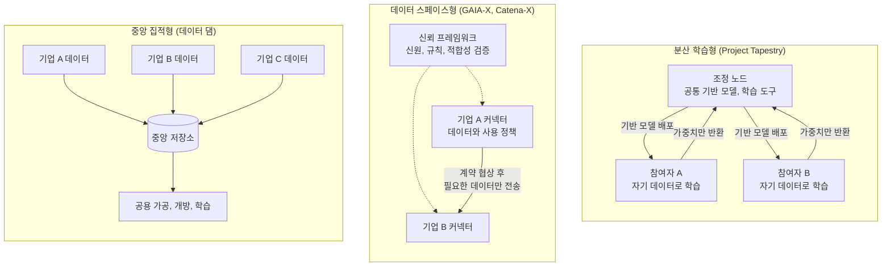
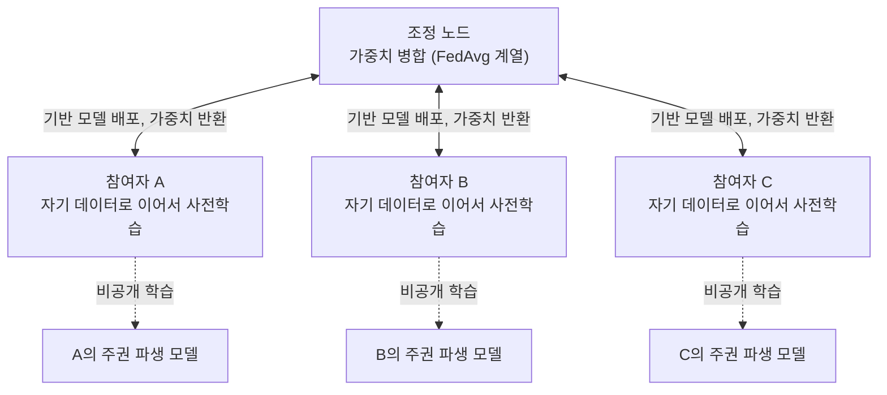

<small><em>English version: <a href="{{ '/blog/2026/industrial-data-sovereignty/' | relative_url }}">Data Sovereignty: From Data Dams to Data Spaces and Consortium Training</a></em></small>



산업 AI를 이야기하다 보면 결국 데이터 이야기로 돌아오게 되는데요, 모델 구조나 연산 자원보다 공장과 공급망 곳곳에 흩어진 공정, 설비, 품질 데이터를 쓸 수 있느냐가 성패를 가르는 경우가 많기 때문입니다. 그래서인지 최근 정책 문서와 과제 기획에서 '데이터 주권'이라는 말이 부쩍 자주 보이는 것 같아요.

몇 년 전까지 데이터 정책의 중심 그림은 '모으는 것'이었습니다. 2020년 한국판 뉴딜의 데이터 댐은 양질의 데이터를 한곳에 모아 가공하고 개방해 누구나 AI 학습에 쓰게 하려는 구상이었습니다. 다만 요즘 유럽과 글로벌 AI 커뮤니티에서 보이는 흐름은 방향이 반대인 것 같습니다. 데이터는 소유자에게 그대로 두고 계약된 범위에서만 쓰거나, 아예 공통의 파라미터와 학습 도구를 데이터 쪽으로 보내 학습시킨 뒤 파라미터만 돌려받는 방식이 적용될 수 있습니다. 데이터 활용의 주도권을 몇몇 집적 거점이 아니라 각 소유자에게 나눠 주는, 일종의 민주화이자 분산화에 가깝다고 생각합니다.

이번 글에서는 이 흐름을 이끄는 움직임을 차례로 정리해 보았습니다. 유럽의 GAIA-X와 그 위에서 자란 Catena-X, Manufacturing-X 같은 산업 데이터 스페이스, 이들을 클라우드-엣지 인프라와 산업 AI 투자로 묶는 IPCEI, 그리고 AI Alliance가 2026년 4월 발표한 Project Tapestry입니다.

## 모으는 방식이 남긴 질문

데이터 댐은 디지털 뉴딜 10대 대표과제의 첫 번째였습니다. 공공데이터 14만여 개 개방, AI 학습용 데이터 1,300여 종 구축, 빅데이터 플랫폼 30개를 목표로 했는데요, 그중 AI 학습용 데이터 구축 사업은 2017년부터 2024년까지 1조 6,328억원을 들여 908종의 데이터를 만들어 AI 허브로 공개했습니다.[^dam]

성과와 함께 숙제도 남았습니다. 감사원은 2024년 5월, 2020~2021년에 구축한 360종 가운데 168종이 당초 품질 목표에 못 미쳤다고 지적했고, 2026년 8월에는 기관 사이의 중복 구축과 제3자 품질 검증 없이 공개된 데이터를 짚었습니다.[^audit] 다만 더 근본적인 한계는 이 방식이 공개해도 되는 데이터를 중심으로 굴러간다는 점이라고 생각합니다. 산업 AI에 정말 필요한 공정 조건, 설비 이력, 불량 데이터는 기업의 영업비밀이라 한곳에 모으기 어렵거든요. 2022년 시행된 산업 디지털 전환 촉진법이 산업데이터를 만든 자에게 사용, 수익할 권리를 인정한 것도 같은 맥락으로 읽힙니다.[^law] 모아서 개방하는 방식으로는 닿지 않는 데이터가 있고, 그 데이터가 산업 AI의 핵심이라는 점이 데이터 주권 논의의 출발점인 셈이에요. 그럼 모으지 않고도 데이터를 쓸 수 있게 하려면 어떤 방식이 있을까요?

## 데이터 주권을 구현하는 세 가지 방식

국제데이터스페이스협회(IDSA)는 데이터 주권을 데이터의 생애 전체에 걸쳐 누가 데이터를 통제하고 누가 책임지는가의 문제로 설명합니다.[^idsa] 이를 구현하는 방식은 무엇이 움직이는지에 따라 세 가지 정도로 나눠 볼 수 있을 것 같아요.

| 구분        | 중앙 집적형                 | 데이터 스페이스형                 | 분산 학습형                                  |
| ----------- | --------------------------- | --------------------------------- | -------------------------------------------- |
| 데이터 위치 | 중앙 저장소                 | 소유자 시스템                     | 소유자 시스템                                |
| 이동 대상   | 원본 데이터                 | 계약 범위의 데이터                | 모델 가중치                                  |
| 신뢰 장치   | 운영 기관의 관리            | 신원 증명, 사용 정책, 계약 협상   | 참여자 선정, 가중치 병합 규칙, 보안 집계     |
| 대표 사례   | 데이터 댐, AI 허브          | GAIA-X, Catena-X, Manufacturing-X | Project Tapestry, 연합학습                   |
| 한계        | 영업비밀 데이터 확보 어려움 | 계약 후에는 데이터 자체가 이동    | 가중치를 통한 정보 유출, 오염 공격 대응 필요 |

중앙 집적형에서는 원본 데이터가 움직입니다. 데이터 스페이스형에서는 데이터가 소유자 시스템에 머물다가 계약이 맺어진 범위에서만 상대에게 건너가구요. 분산 학습형에서는 데이터가 끝까지 움직이지 않고, 모델이 데이터 쪽으로 가서 학습한 뒤 가중치만 돌아옵니다. 이번 글에서 관심을 두는 것은 뒤의 두 방식이고, 각각을 대표하는 사례로 GAIA-X 계열의 데이터 스페이스와 Project Tapestry를 골라 보았습니다.

## GAIA-X: 유럽 클라우드에서 신뢰 프레임워크로



<small><em>GAIA-X Digital Clearing House 안내 쪽. 출처: <a href="https://gaia-x.eu/services-deliverables/digital-clearing-house/">gaia-x.eu</a> (2026-10-13 화면 갈무리)</em></small>

GAIA-X는 2019년 10월 도르트문트 디지털 정상회의에서 페터 알트마이어 당시 독일 경제장관이 처음 내놓았습니다. 미국 클라우드 사업자에 대한 대안으로, 유럽이 주도하는 데이터/클라우드 네트워크를 만들겠다는 구상이었는데요.[^gx-origin] 2020년 6월 프랑스와 독일 장관이 양국 기업 각 11곳, 모두 22개 기업과 함께 조직을 공식화했고, 언론은 이를 '클라우드의 에어버스'라고 불렀습니다. 같은 해 9월 브뤼셀에서 국제비영리협회(AISBL) 설립 서류에 서명했고, 협회는 2021년 2월 벨기에법상 지위를 얻었습니다.[^gx-found]

출발은 순탄하지 않았는데요, 마이크로소프트, 아마존, 구글, 알리바바 같은 비유럽 사업자가 회원으로 들어오면서 '트로이의 목마'라는 우려가 나왔고, 2021년 11월에는 창립 회원이던 Scaleway가 GAIA-X가 현상 유지를 강화할 뿐이라며 회원을 갱신하지 않겠다고 밝혔습니다. EU 밖 회원은 이사회에 들어갈 수 없게 하는 것으로 정리되었지만, 성과가 더디다는 비판은 그 뒤로도 이어졌습니다.[^gx-critic]

그 과정에서 GAIA-X의 성격도 바뀌었다고 보는데요, 지금의 GAIA-X는 스스로를 클라우드 사업자가 아니라고 밝히고, 데이터를 주고받는 참여자들이 서로를 믿을 수 있게 하는 규칙과 검증 체계를 제공하는 쪽에 가깝습니다.[^gx-faq] 주요 구성은 다음과 같습니다.

- **Trust Framework**: 컴플라이언스 기준, 기술 호환성 명세와 오픈소스 툴킷, 생태계별 신뢰 프로파일을 공개하는 Trust Protocol로 구성됨
- **라벨**: 표준 컴플라이언스부터 Level 1~3까지 단계별로 데이터 보호, 제3자 검증, EU 본사 요건을 더함
- **Digital Clearing House(GXDCH)**: 2023년부터 시장 운영자들이 노드를 운영하며 GAIA-X 규칙에 대한 적합성 검증을 자동으로 수행함
- **신원 증명**: W3C 검증 가능한 자격증명(VC)으로 참여자와 서비스의 신원, 적합성을 증명함

실제 데이터 교환은 IDSA가 만든 Dataspace Protocol과 그 참조 구현인 Eclipse Dataspace Components(EDC) 커넥터가 맡습니다. 데이터 소유자의 커넥터가 기계가 읽을 수 있는 사용 정책(ODRL)을 붙여 데이터를 제공 목록에 올리면, 사용자는 프로토콜에 따라 계약을 협상한 뒤에야 점대점으로 데이터를 받는 구조예요. Catena-X가 쓰는 커넥터 문서는 모든 전송에 앞서 양측이 조건을 공식적으로 수락한다고 설명합니다.[^edc] 이 프로토콜은 2025년 12월 ISO/IEC JTC 1의 표준화 절차에 들어갔습니다.[^dsp]

2026년 GAIA-X는 기반을 다지는 단계를 지나 대규모 확산을 노리는 'Season 2.0'을 선언했고, 회원은 220여 곳, 국가별 허브는 25곳입니다. 한국에도 2025년 11월 Gaia-X Hub Korea가 문을 열었습니다.[^gx-now] 2025년 9월부터 적용된 EU 데이터법도 이 흐름의 제도적 바탕이 되고 있는 듯 합니다.

## Catena-X와 Manufacturing-X: 산업 현장으로 내려온 데이터 스페이스



<small><em>Catena-X 첫 화면. 출처: <a href="https://catena-x.net/">catena-x.net</a> (2026-10-13 화면 갈무리)</em></small>

GAIA-X의 원칙을 산업 현장에 처음 옮긴 사례가 자동차 산업의 Catena-X입니다. BMW, 도이치텔레콤, 보쉬, SAP, 지멘스, ZF가 꾸린 얼라이언스는 2021년 3월 Catena-X Automotive Network라는 이름을 내걸었고, 같은 해 협회(e.V.)로 출범했습니다. 독일 연방경제부가 2021년부터 2024년까지 1억 유로 남짓을 지원했고, GAIA-X의 첫 산업 등대 사업으로 꼽히기도 합니다.[^cx-found]

Catena-X는 역할 분담이 분명한 편인데요, 협회가 표준과 인증을 맡고, Eclipse Tractus-X가 오픈소스 참조 구현을 제공하며, 운영사가 식별과 온보딩, 마켓플레이스를 운영합니다. 첫 운영사 Cofinity-X는 2023년 1월 BMW, 메르세데스-벤츠, SAP, 지멘스, 폭스바겐 등 10개사 합작으로 세워졌고, 네트워크는 2023년 10월 운영을 시작했습니다.[^cx-op] 표준 CX-0018은 모든 커넥터에 Dataspace Protocol과 ODRL 사용 정책, VC 기반 신원을 요구하고, CX-0002는 Industrie 4.0의 자산관리셸(AAS)로 부품과 제품의 디지털 트윈을 표현하게 합니다.[^cx-std] AAS가 데이터의 의미를, 커넥터가 계약과 정책을 맡는 분업이라고 볼 수 있겠죠.

다섯 해가 지난 지금 Catena-X는 운영 단계에 들어선 것 같아요. 2026년 9월 발표에 따르면 데이터를 교환하는 완성차/부품 기업이 1,069곳으로, 2025년 12월 182곳에서 아홉 달 만에 다섯 배 넘게 늘었습니다. 품질 관리 사례에서는 문제를 평균 4개월 먼저 찾아냈고, 공급망 1차 데이터로 산정한 제품 탄소발자국(PCF)이 산업 평균값으로 계산한 것보다 46% 낮게 나온 사례도 소개되었습니다.[^cx-growth] 2027년 2월부터 적용되는 EU 배터리 여권 의무에 대비한 공동 시나리오도 시작했고, 북미 AIAG, 중국 CAAM과 손잡는 한편 일본 Ouranos 생태계와 상호운용을 실증하는 등 국경 밖으로도 넓어지고 있는 모습입니다.[^cx-intl]

자동차에서 검증된 구조를 제조 전반으로 넓힌 것이 Plattform Industrie 4.0이 주도하는 Manufacturing-X입니다. 독일 연방경제부는 2023년 8월 최대 1억 5천만 유로 규모로 공모했고, 2025년 10월까지 약 1억 4천만 유로가 124개 기업과 연구기관이 참여하는 10개 과제에 배정되었습니다.[^mx] 공장 장비 공급사와 운영사를 잇는 Factory-X(지멘스, SAP 주도, 47개 파트너)는 2026년 6월 마무리되어 코드를 Tractus-X로 넘겼고, 항공(Aerospace-X), 반도체(Semiconductor-X), 화학(Chem-X) 같은 과제도 함께 진행되었습니다. Factory-X와 Semiconductor-X 등은 Catena-X의 아키텍처와 Tractus-X 코드를 바탕으로 삼았는데요, 자동차에서 만든 구조가 다른 업종으로 이어진 셈이에요.[^fx]

한국과의 접점도 생기고 있는데요, 2023년 10월 출범한 International Manufacturing-X Council에 스마트제조혁신추진단이 창립 참여했고, 2024년 4월에는 KIAT와 Plattform Industrie 4.0이 공동연구 협약을 맺었습니다. 2025년 10월 두 번째 한-독 산업데이터 협력 포럼을 거쳐, 산업통상부는 2026년부터 2029년까지 296억원 규모로 산업데이터 스페이스 표준모델(Manufacturing-X 플랫폼 표준모델)의 개발과 실증을 추진하고 있습니다.[^kr-mx]

## IPCEI: 인프라와 산업 AI를 묶는 투자 틀

그럼 규칙과 데이터 교환 말고 인프라와 AI 모델 쪽은 어떻게 움직이고 있을까요? GAIA-X가 규칙을, Catena-X와 Manufacturing-X가 산업별 데이터 교환을 맡는다면, 그 아래 인프라와 그 위 AI 모델에 대한 대규모 투자는 IPCEI(유럽 공동 이익에 관한 중요 프로젝트)가 맡고 있습니다. IPCEI는 여러 회원국이 함께 설계한 대형 혁신 사업에 국가보조를 허용하는 EU의 제도입니다.

클라우드 쪽은 2023년 12월 승인된 IPCEI-CIS입니다. 프랑스, 독일, 이탈리아 등 7개국이 최대 12억 유로를 지원하고 민간 투자 14억 유로를 끌어내는 사업으로, 19개 기업이 2031년까지 '다중 사업자 클라우드-엣지 연속체'를 만드는 계획입니다.[^cis] 참여자들은 8ra라는 상위 체계를 꾸려 12개국 120여 개 파트너가 함께 쓰는 참조 아키텍처를 내놓고 있습니다. 2026년 8월 공개된 3.0판에는 데이터 제공과 계약, 데이터 정책 통제가 데이터 계층의 기능으로 들어가 있고, 데이터 연합은 커넥터로 소유자의 통제를 유지하도록 되어 있습니다.[^icra] 승인 문서에 GAIA-X가 직접 등장하지는 않지만, 독일 정부는 처음부터 이 사업이 GAIA-X에 자연스럽게 이어진다고 설명했고, 산업계에서는 '8ra가 안전한 노드를, GAIA-X가 연결을 맡는다'는 식으로 역할을 나누기도 하는 것 같아요.[^cis-gx]

AI 쪽은 IPCEI-AI입니다. 2026년 9월 유럽위원회가 19개 회원국의 공동 설계 완료를 환영했고, 국가보조를 줄 11개국이 사전 통보를 시작했습니다. 독일 정부는 150개 이상의 과제와 100억 유로 이상의 투자를 예상하며 2027년 봄 착수를 내다보고 있습니다.[^ipcei-ai] 가치사슬 문서는 언어 모델과 함께 정형화된 비즈니스, 기계 데이터로 학습한 비언어 산업 특화 파운데이션 모델을 구성 요소로 두고, 분야 간 데이터는 데이터 스페이스로 활용한다고 적으며, 관련 사업으로 Manufacturing-X, Catena-X, IPCEI-CIS(8ra)를 명시하고 있거든요.[^vc] 기반 모델에서 산업 특화 모델, 기업 특화 모델로 이어지는 IPCEI-AI의 구조는 [산업 파운데이션 모델은 무엇이어야 하는가]({{ '/blog/ko/foundation-ai-for-industry/' | relative_url }})와 [산업 AI를 위한 Industrial Data Lake 구상]({{ '/blog/ko/industrial-ai-data-factory/' | relative_url }}) 글에서 다룬 적이 있으니 함께 보셔도 좋을 것 같아요.

정리하면 유럽의 그림은 다음과 같은 층으로 나눠 볼 수 있을 것 같습니다.

- **인프라**: IPCEI-CIS, 엣지 쪽 IPCEI-CIC, 8ra 참조 아키텍처
- **신뢰와 규칙**: GAIA-X Trust Framework, 라벨, GXDCH
- **데이터 교환**: Dataspace Protocol, EDC 커넥터, Catena-X, Manufacturing-X
- **AI 모델**: IPCEI-AI의 주권 파운데이션 모델과 산업 특화 파운데이션 모델

## Project Tapestry: 데이터 대신 가중치가 움직인다



<small><em>Project Tapestry 소개 쪽. 출처: <a href="https://thealliance.ai/projects/tapestry">thealliance.ai</a> (2026-10-13 화면 갈무리)</em></small>

데이터 스페이스가 '계약 아래에서 데이터를 옮기는' 방식이라면, Project Tapestry는 데이터를 아예 옮기지 않는 쪽에 가깝습니다. Tapestry를 이끄는 AI Alliance는 2023년 12월 IBM과 Meta가 50여 개 기관과 함께 만든 개방형 AI 연합으로, 2025년 비영리 법인 체제로 바뀌었고 지금은 200여 개 기관이 참여한다고 밝히고 있습니다.[^aia]

2026년 4월 발표된 Tapestry의 표어는 '프런티어 파운데이션 모델과 주권 파생 모델을 위한 컨소시엄 방식의 학습'인데요, 소개 쪽에는 "공유되는 것은 가중치뿐"이라는 문장도 있습니다.[^tap] 공개된 설계 문서를 보면 학습은 두 단계로 나뉩니다.[^tap-adr]

- **공유 기반 루프**: 조정 노드가 공통 기반 모델을 내려보내면 각 참여자가 자기 데이터로 이어서 사전학습하고 가중치만 돌려보냄. 조정 노드는 이를 FedAvg 계열 방식으로 병합해 새 기반 모델을 다시 배포함
- **주권 파생 모델**: 각 참여자가 기반 모델 위에서 비공개로 추가 학습과 정렬을 수행해 자기 모델을 만듦. 이 결과는 공유 기반으로 돌아가지 않음

글 첫머리에 적은 '공통의 파라미터와 학습 도구가 소유자에게 전달되어 학습된 뒤 파라미터만 공유되는' 형태가 바로 이것입니다. 흥미로운 점은 Tapestry가 '연합학습'이라는 이름을 일부러 피한다는 것인데요, 수많은 휴대폰 같은 작은 클라이언트가 아니라 데이터와 연산 자원을 갖춘 소수의 대형 참여자가 함께 모델을 키운다는 뜻에서 '컨소시엄 학습'이라고 부릅니다. 병합 방식도 단순 평균에 묶지 않고 DiLoCo, 모델 병합, 증류 등으로 바꿔 끼울 수 있게 설계했습니다.[^tap-adr]

2026년 9월 발표된 첫 실증(Milestone Zero)에서는 두 가지를 확인했습니다. 인도 BharatGen과 호주 Monash가 각자의 데이터로 7B 모델을 조정해 합친 결과가 문화 관련 평가(GlobalOpinionQA)에서 기반 모델보다 나았고, 미국과 호주의 두 클라우드 거점이 7B 모델을 120억 토큰 규모로 이어서 사전학습하는 동안 학습 데이터는 네트워크로 한 번도 오가지 않았다고 합니다.[^m0] 로드맵은 2026년 말 첫 기반 모델, 2027년 상반기 초기 배포를 거쳐 그 뒤 프런티어 규모로 이어지는 계획입니다.[^tap]

다만 아직 이른 단계라는 점도 함께 봐 두는 것이 좋을 것 같아요. 설계 결정은 모두 '제안' 상태이고, 보안 집계와 차등 프라이버시, 노드의 하드웨어 증명은 요구사항 초안에 들어 있을 뿐 첫 실증에서는 단순 평균을 썼습니다.[^tap-prd] 한국 기관의 참여도 아직 공개되지 않은 상태입니다.

## 산업 AI에 주는 시사점

그럼 이 세 가지 움직임은 산업 AI에 어떤 의미가 있을까요? 나란히 놓고 보면, 데이터 주권은 '데이터를 옮기지 않는 설계'와 '그 사실을 확인할 수 있는 신뢰 체계'가 함께 갈 때 성립한다고 생각합니다. GAIA-X와 Catena-X는 신원, 정책, 계약을 표준으로 만들었고, Tapestry는 데이터 대신 가중치를 옮기는 학습 구조를 시험하고 있습니다. 산업 AI 관점에서 눈여겨볼 점은 다음 정도로 정리해 볼 수 있을 것 같아요.

- **가중치에 남는 데이터의 흔적**: 가중치만 공유해도 멤버십 추론이나 모델 역전 공격으로 학습 데이터가 드러날 수 있고, 참여자 한 곳이 오염된 가중치를 보내면 공통 모델 전체가 영향을 받음. 보안 집계, 차등 프라이버시, 병합 전 가중치 검증이 필요함
- **참여 노드의 실행 환경 증명**: 각 참여자가 약속한 코드와 데이터로 학습했는지 확인하려면 [TEE와 원격 증명]({{ '/blog/ko/confidential-computing-tee-vs-pcc/' | relative_url }})이 다시 필요해짐. 데이터 스페이스의 신원 증명이 기관을 확인한다면, 분산 학습에는 실행 환경을 확인하는 장치가 더해져야 함
- **사용 이력과 모델 이력의 연결**: 데이터가 어떤 계약으로 어디에서 쓰였는지, 그 결과로 어떤 모델이 만들어졌는지를 함께 추적할 수 있어야 함. 데이터 스페이스의 사용 기록과 모델 단위 AI-BOM을 잇는 작업이 필요함
- **클린룸과 분산 학습의 병행**: 산업통상부가 준비 중인 제조 데이터 라이브러리는 외부와 차단된 클린룸 안에서만 데이터를 쓰게 하는 방식임. 반출할 수 있는 데이터는 클린룸에서, 공장 밖으로 내보낼 수 없는 공정 데이터는 분산 학습으로 다루는 구성을 고려해 볼 수 있음

국내에도 기반은 갖춰지고 있는데요, 산업 디지털 전환 촉진법이 산업데이터에 대한 권리를 정했고, 산업데이터 스페이스 표준모델 사업과 Gaia-X Hub Korea가 국제 규약과의 연결 고리를 만들고 있으며, M.AX 얼라이언스는 제조 데이터의 생성, 공유, 활용을 첫 과제로 내걸었습니다.[^kr] 남은 과제는 이들을 Dataspace Protocol, ODRL, VC 같은 국제 규약과 상호운용되게 만드는 일, 그리고 반출할 수 없는 데이터까지 학습에 참여시키는 분산 학습을 안전하게 운용할 기술을 확보하는 일이 아닐까 싶습니다.

데이터 댐이 데이터를 한곳에 모으는 구조였다면, 데이터 주권은 데이터를 제자리에 둔 채 가치가 흐르게 하는 구조에 가깝다고 봅니다. 관심도 '얼마나 모았는가'에서 '어떤 규칙으로 흐르게 하는가', 그리고 '그 규칙이 지켜지는지 확인할 수 있는가'로 옮겨 가고 있는 것 같아요.

## 참고 문헌

[^dam]: SPRi, 김준연, [데이터 경제 활성화를 위한 이슈와 쟁점](https://spri.kr/download/22682) (2020-11); 경향신문, [감사원 AI 산업 육성 실태 감사](https://www.khan.co.kr/article/202608121808001/) (2026-08-12)

[^audit]: 이투데이, [감사원 AI 데이터 구축 사업 감사](https://www.etoday.co.kr/news/view/2362983) (2024-05-23); 서울경제, [감사원 AI 학습용 데이터 감사](https://www.sedaily.com/article/20078676) (2026-08-12)

[^law]: 국가법령정보센터, [산업 디지털 전환 및 인공지능 활용 촉진법](https://www.law.go.kr/LSW/lsInfoP.do?lsiSeq=284365) 제9조

[^idsa]: IDSA, [Data sovereignty](https://internationaldataspaces.org/why/data-sovereignty/)

[^gx-origin]: t-online(dpa), [Gaia-X auf dem Digital-Gipfel](https://www.t-online.de/digital/id_86705406/gaia-x-europaeisches-cloud-projekt-auf-digital-gipfel-gestartet.html) (2019-10-29)

[^gx-found]: 프랑스 경제재정부, [Concrétisation du projet GAIA-X](https://www.economie.gouv.fr/actualites/concretisation-du-projet-gaia-x-une-infrastructure-europeenne-de-donnees) (2020-06-04); Deutsche Telekom, [Gaia-X takes major step](https://www.telekom.com/en/newsroom/latest-updates/news/2020/9/gaia-x-takes-major-step-toward-sovereign-european-digital-infras) (2020-09-15); Elektroniknet, [Gaia-X AISBL is officially founded](https://www.elektroniknet.de/international/gaia-x-aisbl-is-officially-founded.183417.html) (2021-02)

[^gx-critic]: CEPA, [Europe's Cloud Dreams Come Crashing Down to Earth](https://cepa.org/article/europes-cloud-dreams-come-crashing-down-to-earth/) (2021-11); The Register, [Scaleway quits Gaia-X](https://www.theregister.com/2021/11/19/scaleway_gaia_x/) (2021-11-19); DCD, [Has Europe's grand digital infrastructure project hit the buffers?](https://www.datacenterdynamics.com/en/analysis/gaia-x-has-europes-grand-digital-infrastructure-project-hit-the-buffers) (2024-05)

[^gx-faq]: Gaia-X, [FAQ](https://gaia-x.eu/faq/); [Trust Framework architecture](https://docs.gaia-x.eu/technical-committee/architecture-document/latest/trust_framework_architecture/); [Compliance Document 25.10](https://docs.gaia-x.eu/policy-rules-committee/compliance-document/25.10/Introduction_and_scope/); [Digital Clearing House](https://gaia-x.eu/services-deliverables/digital-clearing-house/)

[^edc]: Eclipse Tractus-X, [Connector KIT: Adoption View](https://eclipse-tractusx.github.io/docs-kits/kits/connector-kit/adoption-view/)

[^dsp]: Eclipse Foundation, [Dataspace Protocol and Decentralized Claims Protocol enter ISO/IEC JTC 1](https://newsroom.eclipse.org/node/43194) (2025-12-02)

[^gx-now]: Gaia-X, [Season 2.0](https://gaia-x.eu/gaia-x-appoints-new-chair-of-governmental-advisory-board-to-lead-next-phase-of-data-space-adoption/) (2026-04); Ulrich Ahle, [Gaia-X 발표 자료](https://www.csipiemonte.it/sites/default/files/inline_download/eventi/2026/AHLE.pdf) (2026-05); Gaia-X, [Gaia-X Hubs expand to Canada and Korea](https://gaia-x.eu/gaia-x-hubs-expand-to-canada-and-korea-marking-a-milestone-in-global-digital-cooperation/) (2025-11-26); European Commission, [Data Act](https://digital-strategy.ec.europa.eu/en/policies/data-act)

[^cx-found]: BMW Group, [The alliance for secure and cross-company data exchange](https://www.press.bmwgroup.com/global/article/detail/T0326851EN/the-alliance-for-secure-and-cross-company-data-exchange-in-the-automotive-industry-is-picking-up) (2021-03-02); Catena-X, [Catena-X network grows by more than a factor of five to over 1000 companies](https://catena-x.net/news/catena-x-network-grows-by-more-than-a-factor-of-five-to-over-1000-companies/); DLR, [Catena-X](https://www.dlr.de/en/ki/research-transfer/projects/catena-x)

[^cx-op]: BMW Group, [Foundation of the joint venture Cofinity-X](https://www.press.bmwgroup.com/global/article/detail/T0406123EN/with-the-foundation-of-the-joint-venture-cofinity-x-ten-partners-of-the-automotive-industry-will-further-foster-the-adoption-of-the-catena-x-network) (2023-01-31); Telekom DIH, [Countdown for Catena-X going live](https://dih.telekom.com/de/countdown-for-catena-x-going-live-on-october-16-) (2023-10)

[^cx-std]: Catena-X, [CX-0018 Dataspace Connectivity](https://catenax-ev.github.io/docs/standards/CX-0018-DataspaceConnectivity); [CX-0002 Digital Twins in Catena-X](https://catenax-ev.github.io/docs/standards/CX-0002-DigitalTwinsInCatenaX)

[^cx-growth]: Catena-X, [Catena-X network grows by more than a factor of five to over 1000 companies](https://catena-x.net/news/catena-x-network-grows-by-more-than-a-factor-of-five-to-over-1000-companies/) (2026-09-21)

[^cx-intl]: Catena-X, [Battery Passport Scenario](https://catena-x.net/news/invitation-to-participate-in-the-battery-passport-scenario/) (2026-09); Automotive Logistics, [Catena-X signs MoU with AIAG](https://www.automotivelogistics.media/digitalisation/catena-x-signs-mou-with-aiag-to-expand-data-sharing-network-in-north-america/206553) (2024-10); Catena-X, [China pilot with CAAM and VDA](https://catena-x.net/news/catena-x-caam-and-vda-launch-first-china-pilot-with-50-companies-advancing-global-data-collaboration/) (2025-07); IPA, [Catena-X and Ouranos Ecosystem interoperability](https://www.ipa.go.jp/en/pressrelease/press20250331.html) (2025-03-31)

[^mx]: BMWK, [Förderaufruf Manufacturing-X](https://www.bundeswirtschaftsministerium.de/Redaktion/DE/Pressemitteilungen/2023/08/20230821-foerderaufruf-manufacturing-x-zum-bau-des-digitalen-oekosystems-gestartet.html) (2023-08-21); BMWE, [Manufacturing-X](https://www.bundeswirtschaftsministerium.de/Redaktion/EN/Dossier/manufacturing-x.html)

[^fx]: [Factory-X](https://factory-x.org/); Computer & Automation, [Projektabschluss Factory-X](https://www.computer-automation.de/produktionssoftware/projektabschluss-factory-x-schafft-grundlage-fuer-interoperable-datenraeume-und-industrielle-ki.htm) (2026-06-18); [Eclipse Tractus-X](https://eclipse-tractusx.github.io/)

[^kr-mx]: Business Wire, [International Manufacturing-X Council](https://www.businesswire.com/news/home/20231025733222/en) (2023-10-25); 뉴스서울, [KIAT와 Plattform Industrie 4.0 협약](https://newsseoul.co.kr/news/view/1065588621205357) (2024-04-24); 파이낸스스코프, [제2회 한-독 산업데이터 협력 포럼](https://www.finance-scope.com/article/view/scp202510230016) (2025-10-23); 산업통상부, [M.AX 얼라이언스 정기총회](https://www.motir.go.kr/kor/article/ATCL3f49a5a8c/171390/view) (2025-12-24)

[^cis]: European Commission, [IP/23/6246: Commission approves IPCEI in cloud and edge computing](https://ec.europa.eu/commission/presscorner/api/files/document/print/en/ip_23_6246/IP_23_6246_EN.pdf) (2023-12-05)

[^icra]: 8ra, [IPCEI-CIS Reference Architecture 3.0](https://www.8ra.com/wp-content/uploads/IPCEI-CIS_Reference-Architecture_3-0.pdf) (2026-08)

[^cis-gx]: BMWK, [Cloud-IPCEI in den Startlöchern](https://www.bundeswirtschaftsministerium.de/Redaktion/DE/Pressemitteilungen/2022/04/20220408-cloud-ipcei-in-den-startlochern.html) (2022-04-08); Industriemagazin, [8ra](https://industriemagazin.at/industrie/8ra-cloud-souveraenitaet-europa-aws-alternative/) (2026-02-06)

[^ipcei-ai]: European Commission, [Commission welcomes design of first IPCEI on AI](https://digital-strategy.ec.europa.eu/en/news/commission-welcomes-design-first-important-project-common-european-interest-ai) (2026-09-16); BMWE, [IPCEI zu KI in den Startlöchern](https://www.bundeswirtschaftsministerium.de/Redaktion/DE/Pressemitteilungen/2026/09/20260917-ipcei-zu-ki-in-den-startloechern.html) (2026-09-17)

[^vc]: [IPCEI-AI Value Chain Description v1.1](https://www.rvo.nl/sites/default/files/2026-02/IPCEI-AI-Value-Chain.pdf) (2025-08)

[^aia]: IBM Newsroom, [AI Alliance launches](https://newsroom.ibm.com/AI-Alliance-Launches-as-an-International-Community-of-Leading-Technology-Developers,-Researchers,-and-Adopters-Collaborating-Together-to-Advance-Open,-Safe,-Responsible-AI) (2023-12-05); PR Newswire, [The AI Alliance forms non-profit AI lab and association](https://www.prnewswire.com/news-releases/the-ai-alliance-forms-non-profit-ai-lab-and-ai-technology--advocacy-association-to-scale-open-source-innovation-302486749.html) (2025-06-20)

[^tap]: PR Newswire, [AI Alliance launches Project Tapestry](https://www.prnewswire.com/news-releases/ai-alliance-launches-project-tapestry-to-build-a-collaborative-foundation-for-open-and-sovereign-ai-302735918.html) (2026-04-07); AI Alliance, [Project Tapestry](https://thealliance.ai/projects/tapestry)

[^tap-adr]: The AI Alliance, [ADR TAP-002 consortium training](https://github.com/The-AI-Alliance/tapestry/blob/develop/docs/architecture/decisions/adr-002-consortium-training.md); [ADR TAP-004 training loop](https://github.com/The-AI-Alliance/tapestry/blob/develop/docs/architecture/decisions/adr-004-training-loop.md); [ADR TAP-007 architecture comparison](https://github.com/The-AI-Alliance/tapestry/blob/develop/docs/architecture/decisions/adr-007-architecture-comparison.md)

[^m0]: AI Alliance, [Milestone Zero](https://thealliance.ai/blog/milestone-zero-the-findings-a-single-organization-could-not-have-produced) (2026-09-10)

[^tap-prd]: The AI Alliance, [Tapestry PRD (draft)](https://github.com/The-AI-Alliance/tapestry/blob/develop/docs/strategic-plan/PRD.md)

[^kr]: 산업통상부, [M.AX 얼라이언스 정기총회](https://www.motir.go.kr/kor/article/ATCL3f49a5a8c/171390/view) (2025-12-24); 산업통상부, [제조 데이터 라이브러리 구축](https://eiec.kdi.re.kr/policy/materialView.do?num=282257) (2026-06-05); 파이낸셜뉴스, [가이아엑스 한국 허브 설치 합의](https://www.fnnews.com/news/202410151031042893) (2024-10-15)
