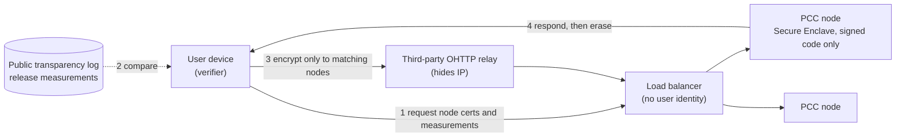

<small><em>한국어 버전: <a href="{{ '/blog/ko/confidential-computing-tee-vs-pcc/' | relative_url }}">기밀 컴퓨팅: TEE와 PCC, 부품과 시스템 사이</a></em></small>



The [previous post]({{ '/blog/2026/trusted-execution-environments/' | relative_url }}) was about running AI models inside a Trusted Execution Environment, mostly a hardware story: enclave memory that is too small, trust that stops at the CPU, and an expensive encrypted hop between CPU and GPU. This time I want to move one level up and ask a simpler question. If you have a TEE, do you have an AI service that users can actually trust?

The trigger for the question is Apple's Private Cloud Compute (PCC). PCC is often described as "Apple's confidential computing," but it is not a technology at the same layer as a TEE. A TEE is an isolated region the processor gives you. PCC is a service design that uses that isolated region as its foundation and stacks a good deal on top. So "TEE vs. PCC" is less a contest than a way to see what is missing between a component and a system, and how PCC fills the gap.

## Confidential computing, briefly

The Confidential Computing Consortium defines confidential computing as protecting data in use by performing computation in a hardware-based, _attested_ TEE.[^ccc] The word that matters is "attested." Isolation alone is not enough; someone outside has to be able to check it.

The flow goes roughly like this. The CPU carves out an isolated region and the memory controller encrypts its memory with a per-TEE key. When the TEE starts, the hardware measures the firmware, kernel and application that were loaded and signs a report with a key fused into the chip. The data owner verifies that report and only then releases the decryption key. Isolation and encryption keep others from _seeing_; attestation tells you whether you can _trust_.

All familiar. But the flow hides an assumption: **who verifies the attestation**, and **what reference they use to decide that a measurement is "good."** Most of the difference between PCC and ordinary cloud confidential computing comes down to that assumption.

## What cloud confidential computing protects

All three major clouds offer CPU-TEE confidential VMs as generally available products. Azure and Google Cloud put their own attestation services in front of AMD SEV-SNP and Intel TDX, and GPU TEEs are on offer too: Azure with H100 (GA September 2024) and Google Cloud with H100 (GA July 2025) and Blackwell-based RTX PRO 6000 (GA August 2026).[^gcp] AWS takes a slightly different line, building the Nitro system so that operators have no mechanism to reach customer data, and backing that with contract terms and an independent NCC Group review.[^nitro]

The trust model is fairly clear. Not trusted: the cloud operator, the hypervisor, host management software, other tenants. Trusted: the CPU and GPU vendors' hardware, firmware and certificate chains. Physical attacks are mostly out of scope. When TEE.fail showed in October 2025 that a DDR5 bus interposer costing under $1,000 could extract attestation keys from SGX, TDX and SEV-SNP, AMD and Intel both reiterated that physical attacks are outside their threat model.[^teefail]

And here is the key point. In cloud confidential computing, **the party that verifies attestation and releases keys is the tenant, the customer running the workload.** The tenant trusts its own code and distrusts the cloud provider. That works well when a bank processes its own transactions in the cloud, or hospitals train a joint model without handing each other their records. The data owner _is_ the verifier.

## When you also distrust the service operator

Personal AI changes the picture. When I ask an assistant on my phone to summarize my mail, the request goes to the service operator's servers. I am the data owner, and the operator sits in the "tenant" seat of cloud confidential computing. Cloud confidential computing can protect the operator's workload from the cloud provider; **it does not protect my data from the operator.** I have no way to see what the operator runs inside the TEE, whether it logs, or whether it left a debug shell open.

Put differently, a TEE guarantees "code with this hash is running on this hardware." What that code does, whether it keeps my data, whether an on-call engineer can get in during an incident: the TEE does not answer any of that. System design has to. PCC can be read as an attempt to answer exactly those questions.

## What PCC builds on top of the TEE

Apple announced PCC in June 2024 with five requirements.[^pcc] Putting each requirement next to what a TEE gives you alone, and what PCC adds, makes the difference easy to see.

| Requirement                  | What a TEE alone gives                         | What PCC adds                                                                                                                               |
| ---------------------------- | ---------------------------------------------- | ------------------------------------------------------------------------------------------------------------------------------------------- |
| Stateless computation        | Memory encryption, key destruction at teardown | No general-purpose logging, only audited structured logs leave the node, data-volume key re-randomized every reboot (cryptographic erasure) |
| Enforceable guarantees       | Hardware isolation                             | No reliance on external components such as TLS-terminating load balancers for core protections                                              |
| No privileged runtime access | Hypervisor and host OS shut out                | No remote shell or interactive debugging, no Developer Mode, only approved signed code, no JIT                                              |
| Non-targetability            | Not addressed                                  | Third-party OHTTP relay hides source IP, blind-signature single-use credentials, requests encrypted only to a subset of nodes               |
| Verifiable transparency      | Signed measurements (attestation report)       | Every production image measurement in an append-only transparency log, public Virtual Research Environment, bounty                          |

A few of these deserve a closer look.

**The verifier moves to the user's device.** In PCC the party checking attestation is not an Apple server but the user's phone or Mac. The device encrypts its request only to the public keys of nodes whose attested measurements match a software release in the public transparency log. If the operator quietly deploys different code, that code isn't in the log and the device simply won't send it data. The operator has taken itself out of the trust boundary.

**The reference for "good" is public.** Attestation only means something if someone can check what the measurements stand for. Apple publishes production images, ships a VRE that boots PCC node software as a VM on a Mac, and pays up to $1M for remote code execution on PCC.[^pccresearch] Attestation shows you a hash; transparency and outside scrutiny give you a reason to believe it.

**No targeting a particular user.** Requests go through a third-party OHTTP relay that hides the source IP. The load balancer holds no user identity, so it can't steer a given user to a given node. Even a compromised node can't pick whose data it sees. TEEs have no notion of this at all.

<small><em>Figure 1. Simplified PCC request flow, based on Apple's public material. Drag to pan, scroll to zoom.</em></small>

Side by side:

|                       | Cloud TEE (confidential VM, GPU TEE)         | Apple PCC                                               |
| --------------------- | -------------------------------------------- | ------------------------------------------------------- |
| Layer                 | Component provided by processor and platform | Service design built on TEEs                            |
| Not trusted           | Cloud provider, hypervisor, other tenants    | All of those, plus the service operator (Apple) itself  |
| Who verifies          | Tenant (service operator)                    | End user's device                                       |
| Reference for "good"  | Measurements the tenant expects              | Release measurements in a public log                    |
| Operator access       | Up to tenant configuration                   | Shell, debugging, Developer Mode removed                |
| Targeted attacks      | Out of scope                                 | OHTTP relay, blind signatures, auditable node selection |
| External verification | Vendor docs, audit reports                   | Published images, VRE, bounty                           |

## June 2026: PCC moves onto commodity cloud TEEs

The interesting part came this June. Apple extended PCC to Google Cloud, combining Intel TDX, NVIDIA Blackwell confidential GPUs and Google's Titan chips.[^expand] PCC originally stood on Apple's own hardware, Apple silicon servers with the Secure Enclave. Now part of that foundation is confidential computing that anyone can rent. The target is the heaviest work: agentic tool use and complex reasoning.

The design principles Apple listed for the extension say a lot about how it views the TEE:

- **Multiple roots of trust**: any component that could be used to exfiltrate user data must attest from at least two independent roots of trust from different vendors
- **Hardware ledger**: all Google Cloud hardware in PCC is tracked in a cryptographically verifiable append-only ledger
- **Not relying on confidential computing alone**: firmware, host and guest OS and applications are all treated as TCB, and defense against side channels and privileged access is not left to confidential computing by itself
- **Same principles**: the five original requirements stay unchanged

With physical attacks like TEE.fail appearing regularly, this reads as a choice not to bet everything on one vendor's TEE, but to layer roots of trust from several vendors and cover the rest with system design. Signal splitting secrets across three different TEE types follows the same logic. A TEE is necessary but not sufficient, and PCC is a design that says so openly.

Others are converging on the same shape. Meta's WhatsApp Private Processing (SEV-SNP plus H100, third-party relay, measurements checked against a third-party log), Google's Private AI Compute (confidential VMs and a TPU enclave, IP-blinding relay), and OpenAI Private Intelligence announced at DevDay in September all combine **TEEs, remote attestation, a third-party relay and a public log**.[^meta][^google] For personal AI, that combination is becoming the practical baseline.

## What this means for industrial AI

PCC is a consumer service, but the question it raises carries straight over to industrial AI. On a factory floor, the party with the model (an equipment vendor) and the party with the data (the plant) are often different. "We run it in a TEE, so it's safe" then has the same limits as pre-PCC cloud confidential computing. If the data owner can't verify for themselves, it collapses back into "trust the operator."

The design principles worth borrowing from PCC:

- **Design the flow, not the component**: attest the environment, then provision keys and data, execute in isolation, and release only permitted results
- **Put the verifier next to the data owner**: who checks attestation matters more than which TEE you use
- **Publish what measurements mean**: without a transparency log or reproducible builds, attestation is just "please trust me"
- **Several roots of trust**: don't stake everything on one vendor's TEE; layer physical security and system hardening around it

Closer to home, Korea still has work to do. Publicly available material shows no domestic cloud provider offering a TEE product on its own infrastructure; KT's Secure Public Cloud is built on Azure confidential computing. For data collaboration that never releases raw data, or for public-sector AI services, domestic attestation-verification and transparency infrastructure will need to be built alongside the hardware.

If a TEE is the technology that keeps others from _seeing_, PCC is the system that lets users _check_. The next problems in confidential computing are probably less about the chip and more about that checkability. In the next post I'll turn the other way: taking zero trust, which grew up at the system and network level, down inside the hardware, all the way to a robot's joints.

## References

[^ccc]: Confidential Computing Consortium, [A Technical Analysis of Confidential Computing v1.3](https://confidentialcomputing.io/wp-content/uploads/sites/10/2023/03/CCC-A-Technical-Analysis-of-Confidential-Computing-v1.3_unlocked.pdf)

[^gcp]: Google Cloud, [Confidential VM release notes](https://docs.cloud.google.com/confidential-computing/confidential-vm/docs/release-notes); NVIDIA, [Azure confidential VM with H100 GA](https://blogs.nvidia.com/blog/azure-confidential-vm-h100-general-availability)

[^nitro]: AWS, [The Security Design of the AWS Nitro System: No AWS operator access](https://docs.aws.amazon.com/whitepapers/latest/security-design-of-aws-nitro-system/no-aws-operator-access.html); [NCC Group independent review](https://aws.amazon.com/blogs/compute/aws-nitro-system-gets-independent-affirmation-of-its-confidential-compute-capabilities)

[^teefail]: [TEE.fail](https://tee.fail/) (IEEE S&P 2026); [AMD-SB-3040](https://www.amd.com/en/resources/product-security/bulletin/amd-sb-3040.html); [Intel Security Announcement 2025-10-28](https://intel.com/content/www/us/en/security-center/announcement/intel-security-announcement-2025-10-28-001.html)

[^pcc]: Apple Security Research, [Private Cloud Compute: A new frontier for AI privacy in the cloud](https://security.apple.com/blog/private-cloud-compute/) (2024-06)

[^pccresearch]: Apple Security Research, [Security research on Private Cloud Compute](https://security.apple.com/blog/pcc-security-research/) (2024-10)

[^expand]: Apple Security Research, [Expanding Private Cloud Compute](https://security.apple.com/blog/expanding-pcc) (2026-06); Google Cloud, [Powering the next era of confidential AI](https://cloud.google.com/blog/products/identity-security/powering-the-next-era-of-confidential-ai/)

[^meta]: Meta Engineering, [Building Private Processing for AI tools on WhatsApp](https://engineering.fb.com/2025/04/29/security/building-private-processing-for-ai-tools-on-whatsapp/) (2025-04)

[^google]: Google, [Private AI Compute](https://blog.google/technology/ai/google-private-ai-compute/) (2025-11); OpenAI, [DevDay 2026 recap](https://openai.com/index/devday-2026-recap/) (2026-09)
