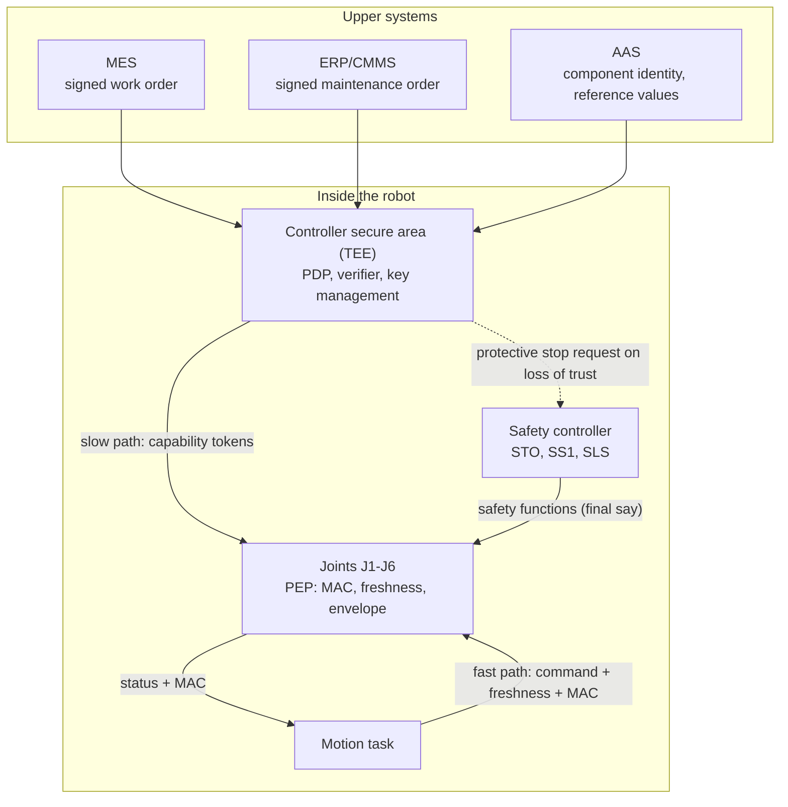

<small><em>한국어 버전: <a href="{{ '/blog/ko/zero-trust-into-hardware/' | relative_url }}">제로 트러스트: 시스템에서 하드웨어로</a></em></small>



Zero trust has become close to common sense in security: never trust, always verify. Being inside the corporate network earns you nothing; every request is checked for who is asking and what they want, and permissions are granted only as far as needed. Follow that principle downward, though, and there is a point where it stops: **the boundary of the device.**

The [previous post]({{ '/blog/2026/confidential-computing-tee-vs-pcc/' | relative_url }}) was about building system design on top of hardware isolation. This one goes the other direction: what happens if you take zero trust, born at the network and system level, and push it inside a machine, all the way to a robot's joints? The example is the most ordinary robot cell there is: parts arrive on a conveyor, a camera finds them, and a robot picks them and places them on a tray.

## Where zero trust stops

NIST SP 800-207, the reference document for ZTA, defines subjects to include applications and non-person entities, and resources to include devices and infrastructure components. It even mentions IoT actuators as resources.[^nist207] By principle alone, the command a robot controller sends to a joint is in scope.

The reference architectures and maturity models tell a different story.

| Document                           | Basic unit                                                     | Device interior                                                                                              |
| ---------------------------------- | -------------------------------------------------------------- | ------------------------------------------------------------------------------------------------------------ |
| NIST SP 800-207 (2020)             | Subjects (people, apps, NPEs), resources (incl. IoT actuators) | Area behind a gateway allowed as an implicit trust zone                                                      |
| CISA ZTMM v2.0 (2023)              | Network-connected devices                                      | Communication between internal components not covered                                                        |
| US DoD ZT for OT (2025-11)         | OT non-person entities, Purdue levels 0-2                      | Devices without certificate support handled as exceptions; OT components inside weapon systems not addressed |
| KISA OT Zero Trust Guide (2025-12) | Plant networks on the Purdue model                             | Real-time and availability first; device interior not specified                                              |

So zero trust doesn't exclude the inside of hardware in principle, but there seems to be no standard yet for identity, authorization and enforcement between components inside a device. A recent survey of chip-level security found that none of 45 SoC/NoC security studies met all zero-trust principles, with per-session authorization, fine-grained access control and continuous verification the most common gaps.[^butka]

Inside a robot this gets concrete. In EtherCAT, widely used in cobots and servo systems, ordinary frames are protected by an FCS, which is a CRC. A CRC catches accidental bit errors; it does nothing against a frame someone crafted on purpose. The cell boundary has firewalls and certificates, the teach pendant has a login, but every command from controller to joint runs on the assumption that "it's on the same bus, so it's fine." That is precisely the assumption zero trust exists to remove.

## Hardware building blocks that already exist

Fortunately, technology for components inside one machine to verify each other is already in use elsewhere. It just isn't called zero trust.

| Domain              | Examples                                                                                       | Meaning inside a robot                                     |
| ------------------- | ---------------------------------------------------------------------------------------------- | ---------------------------------------------------------- |
| In-vehicle networks | AUTOSAR SecOC (truncated MAC, freshness value), MACsec, gateway ECUs                           | Message authentication and segmentation inside one machine |
| Servers, chips      | DMTF SPDM, TCG DICE, OCP Caliptra                                                              | Component identity and firmware-state attestation          |
| Sensors             | MIPI Camera Security (SPDM-based image-sensor authentication)                                  | Per-sensor authenticated sessions                          |
| Servo drives        | Siemens SINAMICS security chip, Rockwell Kinetix (CIP Security), B&R ACOPOS M4 (OPC UA FX)     | Per-drive identity and channel protection                  |
| Robot joints        | ADI secure authenticator reference design (controller-joint mutual auth, session encryption)   | Per-joint mutual authentication                            |
| Fieldbus            | EtherCAT symmetric-key pairing (scenario 3), ETG.1800 security profile draft (2026-09), CANsec | Standardization of in-robot bus security under way         |

Seen this way, zero trust inside a robot is less about inventing new security technology than about re-placing ZTA's logical components (policy decision point PDP, policy enforcement point PEP, policy information point PIP) inside a single composite device, and fitting existing identity, attestation and message-authentication technology to the real-time constraints of a joint. There is pushback, too: the EtherCAT community argues that at field level, hardware-enforced rules are enough and heavy certificate handling should be avoided.[^etg] A phased approach that starts with the most critical commands is probably the more persuasive path.

## How it differs from IT zero trust

Same principle, but inside the robot the words change meaning.

|                   | IT zero trust                 | Zero trust inside a robot                                                                |
| ----------------- | ----------------------------- | ---------------------------------------------------------------------------------------- |
| Resource          | Data, services                | Actuator motion, parameters, firmware, job programs                                      |
| Meaning of access | Read, write, execute          | Whether to move, how far (position, speed, force), and when                              |
| Decision cycle    | Per session (minutes)         | Split: per job (minutes) and per control cycle (sub-ms)                                  |
| Result of denial  | Request fails                 | Transition to a safe state (slow down, protective stop); the stop itself can be a hazard |
| Identity          | Accounts, certificates        | Unique component identity, mounting position (axis), firmware measurement                |
| Policy basis      | Org IAM, data classification  | Robot specs, safety configuration, work orders (MES), maintenance orders (ERP)           |
| Transport         | IP networks                   | Non-IP real-time fieldbus (EtherCAT, CAN)                                                |
| Availability      | Brief interruption acceptable | Directly tied to production and safety; dependence on an external PDP is hard            |

Two changes stand out. First, **access means physical motion, not data.** The policy object isn't "read this document" but "move joint J3 now at no more than 90 degrees per second." Second, **denial isn't free.** In IT a denied request shows the user an error. When a robot rejects a command and slams to a stop, the part it was holding can fly off or an unbraked gravity axis can drop. Given that, robot zero trust should keep "default deny, least privilege, continuous verification," but move decision and enforcement into the robot, redefine access as physical motion, and split the decision cycle into a job-level loop and a control-cycle loop.

## What to check on every command

When a joint receives a command, there are roughly six things to check from a zero-trust point of view.

| Check             | Question                                               | Mechanism                                                | When                                           |
| ----------------- | ------------------------------------------------------ | -------------------------------------------------------- | ---------------------------------------------- |
| Origin            | From the registered controller?                        | Session-key MAC (SecOC-style)                            | Every control cycle                            |
| Freshness         | Not replayed or delayed?                               | Counter or timestamp                                     | Every control cycle                            |
| Sender state      | Controller firmware and config intact?                 | Measured boot, component attestation (DICE, SPDM)        | At startup, on change, periodic re-attestation |
| Authorization     | May this subject request this motion on this axis now? | Capability token issued by the PDP                       | Job start, mode change, events                 |
| Physical envelope | Command value within limits?                           | Per-axis position, speed, torque bounds                  | Every control cycle                            |
| Safety context    | Is it safe to move right now?                          | Operating mode, enabling device, safety controller state | On state change                                |

The physical envelope check is there because several attacks have already shown that authentication alone isn't enough:

- **An authenticated impostor**: steal an SROS2 keystore and you can inject control commands while authenticated as a legitimate participant[^sakib]
- **Plausible tampering**: in an analysis of an industrial robot controller, changing the PID gain on a single axis produced trajectory errors under 2 mm[^quarta]
- **Replaying normal data**: one attack uploaded malicious job code while showing supervisory systems a recording of normal data[^cormand]

Authentication answers "who sent this," not "does what they sent make sense." So the joint should compare the command directly against the envelope written in its capability token. And it runs both ways: a man-in-the-middle experiment on a servo bus dropped commands and returned forged status replies.[^actuator] Both commands (controller to joint) and status (joint to controller) need to be authenticated.

## Six joints that look alike

Identity inside a robot is trickier than it looks. In a six-axis arm, several joints (J4-J6, say) often use the same drive model. Today's bus-level identifiers, such as EtherCAT's vendor ID, product code and serial number, are plaintext and easy to clone, and if two identical drives have their cables swapped, nothing notices. Three separate questions need separate answers: is this part genuine, is its firmware intact, and is it really mounted at J3?

| Layer           | Created                    | Issued by                            | Mechanism                                 | Use in policy                       |
| --------------- | -------------------------- | ------------------------------------ | ----------------------------------------- | ----------------------------------- |
| Device identity | Manufacturing              | Component maker                      | IDevID (IEEE 802.1AR), DICE DeviceID      | Genuineness, provenance             |
| State identity  | Every boot                 | The component itself (DICE layering) | DICE Alias certificate, SPDM measurements | Firmware integrity                  |
| Role identity   | Commissioning, replacement | Integrator or owner CA               | LDevID (IEEE 802.1AR)                     | The name policies refer to (R01/J3) |

DICE suits MCU-class joints well: it derives the next layer's keys from the firmware measurement, so changing the firmware changes the keys. State changes surface without a separate measurement exchange. Role identity exists for policy management. Policies say "allow MOVE on J3," so when a joint is replaced, its device identity changes but a new role identity is issued to the new part and the policy doesn't need editing. Before issuing it, though, you need to confirm the part really sits on that axis: bus topology order, the motor and encoder electronic nameplates, or a tiny single-axis move at reduced speed.

Attestation for the whole robot maps onto the composite-device model in the IETF RATS architecture.[^rats] The controller acts as lead attester, collecting evidence from joints, gripper and camera, and a verifier in the controller's secure area compares it against reference values from the manufacturer or the Asset Administration Shell (AAS). It's the router-chassis model, where the main slot attests on behalf of the line cards, moved into a robot.

## Decide up high, enforce down low

Asking a joint MCU to evaluate a full attribute-based policy every 1 kHz control cycle isn't realistic. A two-speed structure makes more sense: rich decisions above, simple enforcement below.

- **Slow path (per job or event)**: on job start, mode change, entering maintenance or an anomaly, the PDP in the controller's secure area gathers attributes, evaluates policy and issues a capability token to each joint; tens of milliseconds to seconds is fine
- **Fast path (per control cycle)**: the joint PEP checks the MAC, checks freshness and compares against the token's envelope, nothing more

The token carries the target joint, the subject allowed to command it, permitted actions, position/speed/torque bounds, job ID and mode, validity window and session-key ID, signed by the PDP. The joint never has to parse a policy language; it compares a handful of numbers. One published per-command MAC study averaged 7.9 ms per command, too slow for a 1 kHz loop, so hardware crypto acceleration on the joint MCU and measurements on a prototype are a must.

<small><em>Figure 1. Two-speed enforcement for zero trust inside a robot (proposal). Drag to pan, scroll to zoom.</em></small>

Nor does one party write the policy. The component maker knows what the part can withstand, the integrator knows the cell's risk assessment, the owner knows roles and maintenance procedures, and the MES knows what job is running now. Splitting policy into those four layers, each signed by its own author, and granting only the intersection, is worth considering; a deny at any layer is a deny. Standing per-person privileges can likewise become time-limited grants tied to MES work orders and ERP maintenance orders, so an engineer's account can't touch parameters on an axis that isn't in the maintenance order.

## Security only narrows

The most delicate part of zero trust in a robot is how it relates to functional safety. The principle can be put simply: **the security layer may narrow the motion envelope, never widen it.**

- **Keep safety independent**: STO, SS1, SLS and the safety configuration stay separate from security policy, and the functional-safety certification scope doesn't change
- **Where the security envelope sits**: the security PEP's bounds sit inside the safety limits, as a tighter dynamic envelope
- **Staged stopping**: instead of hitting STO on a single bad frame, define stages such as hold last valid command, decelerate, then SS1
- **Keep rescue paths**: manual brake release and similar rescue means stay outside security authorization or remain physical

Network failure is subtler. Zero trust defaults to "deny if not verified." Apply that literally and the moment the MES link drops, every command is rejected and the robot stops hard, which is a hazard of its own. Loss of connectivity should be a design condition rather than an exception, with security and safety designed together so that failures converge to a safe state. While disconnected, grant nothing new; keep moving only within the envelope and validity window of tokens already issued, and when they expire, stop at the end of the cycle. Distinguish faults (a cut cable) from suspected attacks (jamming, forged frames) in the logs, and require re-attestation and an administrator's sign-off to recover when an attack is suspected.

That leaves the case where the controller hosting the PDP itself is compromised, since an attacker could then mint their own tokens. This is where the [TEE story]({{ '/blog/2026/trusted-execution-environments/' | relative_url }}) comes back in. Put the PDP in a TEE or a separate secure MCU isolated from the controller's normal execution, require external inputs such as a signed MES work order to issue tokens, and store integrator-signed upper bounds directly in each joint. Then even a token the PDP signed is rejected if it exceeds those bounds. One point falls, and the upper-layer limits and safety limits still hold.

## What's still missing

Current implementations stop at the "controller" and the "drive." Robot makers have begun certifying controllers to IEC 62443-4-2, and some servo drives have security chips and channel encryption. But the layer that asks whether each individual command between them is permitted is empty, and per-axis, per-motion authorization and runtime re-attestation are hard to find in any public implementation. Safety protocols (FSoE, PROFIsafe) catch accidental errors but leave deliberate forgery to lower layers, and ROS 2's SROS2 is off by default and lets anyone with a stolen key pose as a legitimate participant.

Standards are moving. The EtherCAT security profile (ETG.1800) reached member-review draft in September 2026, and AAS Part 4 covers attribute-based access control. Regulation is close behind: the EU Machinery Regulation applies from January 2027 and the Cyber Resilience Act from December 2027, and ISO 10218-1:2025 now includes cybersecurity requirements insofar as they affect robot safety. For anyone exporting robots and industrial equipment, getting ahead of this looks like the better bet.

The principles of zero trust don't change. What changes is the unit they apply to: from user to device, from device to component, from request to a single command. Along the way, "access" stops meaning data and starts meaning motion, and "deny" stops being an error message and becomes a question of how to stop safely. For zero trust to make it from the system all the way into the hardware, security, safety and real-time control need to be designed at the same table.

## References

[^nist207]: NIST, [SP 800-207 Zero Trust Architecture](https://nvlpubs.nist.gov/nistpubs/SpecialPublications/NIST.SP.800-207.pdf) (2020-08); DoD CIO, [Zero Trust for Operational Technology](https://dodcio.defense.gov/Portals/0/Documents/Library/ZT-OperationalTechnologyActivitiesOutcomes.pdf) (2025-11)

[^butka]: Butka, Bobda, [The Future of Zero-Trust Secured Hardware](https://link.springer.com/article/10.1007/s41635-026-00185-1), Journal of Hardware and Systems Security (2026)

[^etg]: EtherCAT Technology Group, [Explanatory Notes on the Certification of EtherCAT Cybersecurity Capabilities](https://www.ethercat.org/download/documents/Explanatory_Notes_on_EtherCAT_Cybersecurity_Certification.pdf) (2026-04)

[^sakib]: Sakib et al., [Supply Chain Exploitation of Secure ROS 2 Systems](https://arxiv.org/abs/2511.00140), arXiv 2511.00140

[^quarta]: Quarta et al., [An Experimental Security Analysis of an Industrial Robot Controller](https://www.ieee-security.org/TC/SP2017/papers/20.pdf), IEEE S&P 2017

[^cormand]: Pu et al., [CORMAND2](https://www.engineering.org.cn/engi/EN/10.1016/j.eng.2023.01.013), Engineering (2024)

[^actuator]: Jiménez Naharro et al., [Hardware Vulnerabilities in Robotic Actuators](https://www.mdpi.com/2079-9292/14/24/4909), Electronics (2025)

[^rats]: IETF, [RFC 9334 Remote ATtestation procedureS (RATS) Architecture](https://www.rfc-editor.org/rfc/rfc9334.html) (2023-01); TCG, [DICE Architectures](https://trustedcomputinggroup.org/work-groups/dice-architectures/)
