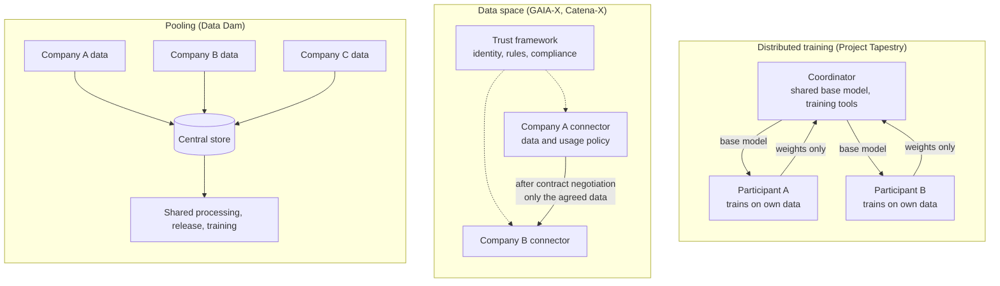
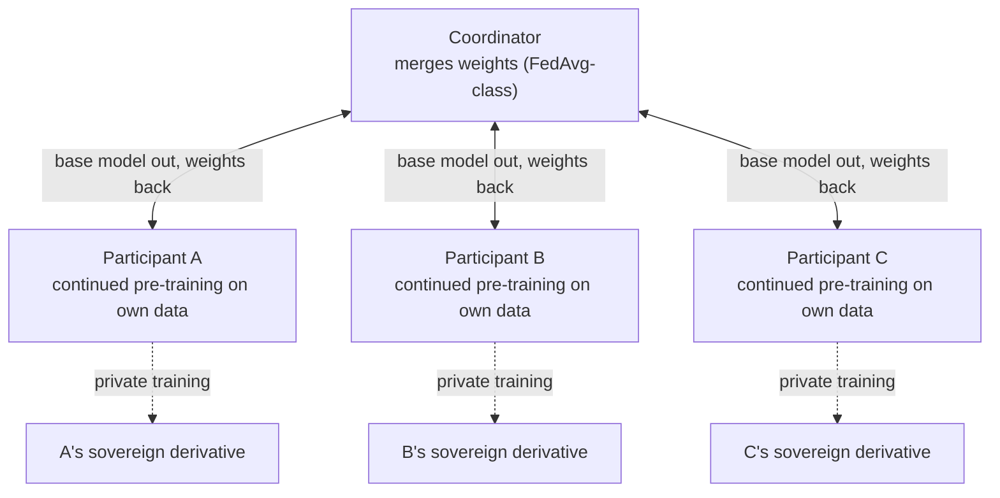

<small><em>한국어 버전: <a href="{{ '/blog/ko/industrial-data-sovereignty/' | relative_url }}">데이터 주권: 데이터 댐에서 데이터 스페이스와 컨소시엄 학습으로</a></em></small>



Talk about industrial AI long enough and you end up talking about data. More often than model architecture or compute, what decides success is whether you can use the process, equipment and quality data scattered across factories and supply chains. Perhaps that is why "data sovereignty" now shows up so often in policy papers and R&D plans.

Until a few years ago the dominant picture in data policy was about pooling. Korea's "Data Dam," launched in 2020 as part of the Korean New Deal, set out to gather good data in one place, process it and open it up so that anyone could use it to train AI. What we see now in Europe and in the global AI community runs the other way. Data stays with its owner and is used only within the scope of a contract, or a shared set of parameters and training tools is sent to the data, trained there, and only the parameters come back. Control over how data is used moves from a few central reservoirs to the owners themselves. You could call it a democratization of data, or a decentralization.

This post walks through the efforts behind that shift: Europe's GAIA-X and the industrial data spaces that grew on top of it, such as Catena-X and Manufacturing-X; the IPCEIs that tie these to cloud-edge infrastructure and industrial AI investment; and Project Tapestry, which the AI Alliance announced in April 2026.

## What pooling left unanswered

The Data Dam was the first of the ten flagship projects of Korea's Digital New Deal. It aimed to open some 140,000 public datasets, build about 1,300 AI training datasets and grow the number of big-data platforms to 30. The AI training data program alone spent KRW 1.63 trillion between 2017 and 2024 to build 908 datasets, published through a national portal called AI Hub.[^dam]

It delivered, and it also left homework. In May 2024 Korea's Board of Audit and Inspection reported that 168 of the 360 datasets built in 2020 and 2021 missed their original quality targets, and in August 2026 it pointed to duplicated work across agencies and to data published without third-party quality checks.[^audit] The deeper limit is that this model runs on data that can be published. The data industrial AI needs most, such as process conditions, equipment histories and defect records, is a company's trade secret and hard to pool anywhere. Korea's Industrial Digital Transformation Act, in force since 2022, grants whoever generates industrial data the right to use it and profit from it, which points the same way.[^law] Some data cannot be reached by collecting and opening, and that data is at the heart of industrial AI. That is where the data sovereignty discussion starts.

## Three ways to implement data sovereignty

The International Data Spaces Association (IDSA) describes data sovereignty as the question of who controls data and who is responsible for it throughout its lifecycle.[^idsa] The ways of putting that into practice can be sorted roughly by what actually moves.

|                      | Pooling                          | Data space                                     | Distributed training                                   |
| -------------------- | -------------------------------- | ---------------------------------------------- | ------------------------------------------------------ |
| Where the data lives | Central store                    | Owner's systems                                | Owner's systems                                        |
| What moves           | Raw data                         | Data within a contract                         | Model weights                                          |
| Trust mechanism      | Operator's governance            | Identity, usage policies, contract negotiation | Participant selection, merge rules, secure aggregation |
| Examples             | Data Dam, AI Hub                 | GAIA-X, Catena-X, Manufacturing-X              | Project Tapestry, federated learning                   |
| Limits               | Trade-secret data hard to obtain | Once contracted, the data itself moves         | Leakage through weights, poisoning                     |

With pooling, the raw data moves. In a data space, the data stays in the owner's systems and crosses over only within the scope of an agreed contract. In distributed training, the data never moves at all: the model goes to the data, trains there, and only weights come back. This post is about the last two, and the leading examples are the GAIA-X family of data spaces and Project Tapestry.

## GAIA-X: from a European cloud to a trust framework



<small><em>The GAIA-X Digital Clearing House page. Source: <a href="https://gaia-x.eu/services-deliverables/digital-clearing-house/">gaia-x.eu</a> (screenshot taken 2026-10-13)</em></small>

GAIA-X was first presented in October 2019 at Germany's Digital Summit in Dortmund by Peter Altmaier, then economy minister, as a European-led data and cloud network and an alternative to US cloud providers.[^gx-origin] In June 2020 the French and German ministers formalized it with 22 companies, eleven from each country, and the press called it "the Airbus of the cloud." That September the founders signed the incorporation papers of an international non-profit association (AISBL) in Brussels, and the association obtained its status under Belgian law in February 2021.[^gx-found]

The start was rocky. Non-European providers such as Microsoft, Amazon, Google and Alibaba joined as members, which raised "Trojan horse" worries, and in November 2021 founding member Scaleway said it would not renew its membership, arguing that GAIA-X was only reinforcing the status quo. The compromise was that members from outside the EU cannot sit on the board, but criticism of slow progress continued for years.[^gx-critic]

Along the way GAIA-X changed character. It now states plainly that it is not a cloud provider; what it offers is a set of rules and verification services that let participants who exchange data trust one another.[^gx-faq] The main pieces:

- **Trust Framework**: compliance criteria, technical compatibility specifications with an open-source toolkit, and a Trust Protocol through which each ecosystem publishes its trust profile
- **Labels**: from Standard Compliance up to Levels 1 to 3, adding data protection, third-party assessment and an EU headquarters requirement step by step
- **Digital Clearing Houses (GXDCH)**: nodes run since 2023 by market operators that check compliance with the GAIA-X rules automatically
- **Identity**: W3C Verifiable Credentials that prove who a participant or service is and what it complies with

The actual data exchange is handled by the Dataspace Protocol, which originated at IDSA, and by its reference implementation, the Eclipse Dataspace Components (EDC) connector. A data owner's connector lists data in a catalog together with machine-readable usage policies (ODRL), and a consumer receives the data peer to peer only after negotiating a contract under the protocol. The connector documentation used in Catena-X states that both parties formally accept the conditions before any transfer takes place.[^edc] The protocol entered the ISO/IEC JTC 1 standardization track in December 2025.[^dsp]

In 2026 GAIA-X declared a "Season 2.0," moving from building foundations to large-scale adoption. It reports about 220 members and 25 national hubs, including Gaia-X Hub Korea, which opened in November 2025.[^gx-now] The EU Data Act, which has applied since September 2025, provides the regulatory backdrop.

## Catena-X and Manufacturing-X: data spaces on the factory floor



<small><em>The Catena-X home page. Source: <a href="https://catena-x.net/">catena-x.net</a> (screenshot taken 2026-10-13)</em></small>

The first place GAIA-X's principles reached the shop floor was the automotive industry, through Catena-X. BMW, Deutsche Telekom, Bosch, SAP, Siemens and ZF founded the alliance, which took the name Catena-X Automotive Network in March 2021 and was registered as an association (e.V.) later that year. The German economy ministry funded it with a little over EUR 100 million between 2021 and 2024, and it is often cited as GAIA-X's first industrial lighthouse project.[^cx-found]

Catena-X divides the work cleanly. The association owns standards and certification, Eclipse Tractus-X provides the open-source reference implementation, and operating companies run identity, onboarding and the marketplace. The first operator, Cofinity-X, was set up in January 2023 as a joint venture of ten companies including BMW, Mercedes-Benz, SAP, Siemens and Volkswagen, and the network went live in October 2023.[^cx-op] Standard CX-0018 requires every connector to implement the Dataspace Protocol, ODRL usage policies and identity based on Verifiable Credentials, while CX-0002 has parts and products described as digital twins using Industrie 4.0's Asset Administration Shell (AAS).[^cx-std] The AAS carries the meaning of the data; the connector enforces the contract and the policy.

Five years in, Catena-X is operating at scale. According to its September 2026 report, 1,069 automakers and suppliers now exchange data on the network, up from 182 in December 2025, more than a fivefold increase in nine months. One quality-management deployment found problems four months earlier on average, and a product carbon footprint (PCF) calculated from primary supply-chain data came out 46% lower than one based on industry averages.[^cx-growth] Catena-X has also started a joint scenario for the EU battery passport, which becomes mandatory in February 2027, and it is reaching beyond Europe: a hub agreement with AIAG in North America, a pilot with CAAM in China, and an interoperability demonstration with Japan's Ouranos ecosystem.[^cx-intl]

Manufacturing-X, led by Germany's Plattform Industrie 4.0, extends the model that worked in automotive to manufacturing as a whole. The economy ministry issued a call worth up to EUR 150 million in August 2023, and by October 2025 about EUR 140 million had gone to ten projects involving 124 companies and research institutes.[^mx] Factory-X, which links machine builders with factory operators (led by Siemens and SAP, 47 partners), concluded in June 2026 and handed its code to Tractus-X; aerospace (Aerospace-X), semiconductors (Semiconductor-X) and chemicals (Chem-X) ran alongside it, and Factory-X and Semiconductor-X among others build on Catena-X's architecture and the Tractus-X code.[^fx]

Korea has points of contact too. Korea's Smart Manufacturing Office was a founding participant in the International Manufacturing-X Council launched in October 2023, and in April 2024 KIAT signed a joint research agreement with Plattform Industrie 4.0. After a second Korea-Germany industrial data forum in October 2025, Korea's industry ministry is now funding a KRW 29.6 billion program for 2026 to 2029 to develop and demonstrate a standard model for industrial data spaces, essentially a Korean Manufacturing-X platform.[^kr-mx]

## The IPCEIs: an investment frame for infrastructure and industrial AI

If GAIA-X supplies the rules and Catena-X and Manufacturing-X handle sector-level data exchange, then large-scale investment in the infrastructure underneath and the AI models on top runs through IPCEIs, Important Projects of Common European Interest. An IPCEI is the EU instrument that allows state aid for large innovation projects designed jointly by several member states.

On the cloud side there is IPCEI-CIS, approved in December 2023. Seven member states, including France, Germany and Italy, are providing up to EUR 1.2 billion in aid, expected to unlock EUR 1.4 billion of private investment, and 19 companies are building a "multi-provider cloud to edge continuum" through 2031.[^cis] The participants created an umbrella called 8ra, with more than 120 partners in 12 countries, which publishes a shared reference architecture. Version 3.0, released in August 2026, makes data offering and contracting and data policy control functions of its data layer, and its data federation relies on connectors that keep data owners in control.[^icra] GAIA-X is not mentioned in the approval documents, but the German government said from the start that the project builds seamlessly on GAIA-X, and industry describes the split as 8ra providing the secure nodes and GAIA-X the connections.[^cis-gx]

On the AI side there is IPCEI-AI. In September 2026 the European Commission welcomed its completed design by 19 member states, and the 11 states that will grant aid began pre-notification. Germany expects more than 150 projects and over EUR 10 billion of investment, starting in spring 2027.[^ipcei-ai] Its value-chain description lists, alongside language models, non-language foundation models for specific sectors trained on structured business and machine data; it says cross-sector data will come through data spaces, and it names Manufacturing-X, Catena-X and IPCEI-CIS (8ra) as related initiatives.[^vc] I have written about IPCEI-AI's chain from base models to sector-specific and company-specific models in [What an Industrial Foundation Model Should Be]({{ '/blog/2026/foundation-ai-for-industry/' | relative_url }}) and [An Industrial Data Lake for Industrial AI]({{ '/blog/2026/industrial-ai-data-factory/' | relative_url }}).

Put together, Europe's picture can be read as a set of layers:

- **Infrastructure**: IPCEI-CIS, IPCEI-CIC on the edge side, the 8ra reference architecture
- **Trust and rules**: the GAIA-X Trust Framework, labels and clearing houses
- **Data exchange**: the Dataspace Protocol, EDC connectors, Catena-X and Manufacturing-X
- **AI models**: IPCEI-AI's sovereign and sector-specific foundation models

## Project Tapestry: the weights move, the data stays



<small><em>The Project Tapestry page. Source: <a href="https://thealliance.ai/projects/tapestry">thealliance.ai</a> (screenshot taken 2026-10-13)</em></small>

If a data space moves data under contract, Project Tapestry does not move the data at all. It is run by the AI Alliance, the open-AI coalition IBM and Meta launched with some fifty organizations in December 2023, which reorganized into non-profit entities in 2025 and now says it has more than 200 member organizations.[^aia]

Tapestry, announced in April 2026, describes itself as "a consortium approach to training frontier foundation models and sovereign derivatives," and its project page states that only the weights are shared.[^tap] Its published design documents split training into two phases:[^tap-adr]

- **Shared-base loop**: the coordinator sends out a shared base model, each participant continues pre-training it on its own data and sends back only the weights, and the coordinator merges them (FedAvg-class by default) and redistributes the new base
- **Sovereign build**: each participant privately trains and aligns its own model on top of the base; none of this flows back into the shared base

This is exactly the pattern described at the top: shared parameters and training tools travel to the data owners, are trained there, and only parameters are shared. Interestingly, Tapestry deliberately avoids the term "federated learning." It is not about millions of small clients like phones but about a small number of large participants with their own data and compute growing a model together, hence "consortium training." The aggregation step is also meant to be swappable, from plain averaging to DiLoCo, model merging or distillation.[^tap-adr]

The first proof points, published in September 2026 as Milestone Zero, showed two things. BharatGen in India and Monash in Australia each tuned a 7B model on their own data, and the merged result beat the base model on a cultural benchmark (GlobalOpinionQA). And two cloud sites, in the US and Australia, continued pre-training a 7B model on 12 billion tokens without any training data crossing the network.[^m0] The roadmap calls for a first base model by the end of 2026, early deployment in the first half of 2027, and frontier scale after that.[^tap]

It is worth being clear about how early this is. All of the architecture decisions are still marked "proposed." Secure aggregation, differential privacy and hardware attestation of nodes appear in the draft requirements, but the first experiments used plain averaging.[^tap-prd] No Korean participant has been named yet.

## What this means for industrial AI

Put the three efforts side by side and a pattern appears: data sovereignty holds only when a design that keeps data in place comes together with a trust system that lets you verify it. GAIA-X and Catena-X turned identity, policies and contracts into standards, and Tapestry is testing a training structure that moves weights instead of data. From an industrial AI point of view, a few points stand out:

- **Weights still carry traces of the data**: even when only weights are shared, membership inference or model inversion can expose training data, and one participant sending poisoned weights can affect the whole shared model. Secure aggregation, differential privacy and checks on weights before merging are needed
- **Attesting the participants' environments**: to know that each participant trained with the agreed code and data, [TEEs and remote attestation]({{ '/blog/2026/confidential-computing-tee-vs-pcc/' | relative_url }}) come back into the picture. Data-space identity proves who an organization is; distributed training also needs a way to prove what ran where
- **Linking usage records to model lineage**: it should be possible to trace under which contract and where data was used, and which models came out of it. That means connecting a data space's usage records to model-level AI-BOMs
- **Clean rooms and distributed training side by side**: The manufacturing data library Korea's industry ministry is preparing allows data to be used only inside a sealed clean room. Data that can leave a company could go there, while process data that cannot leave the factory could be handled by distributed training

Korea already has some of the foundations. The Industrial Digital Transformation Act defines rights over industrial data, the industrial data space standard-model program and Gaia-X Hub Korea are building links to international frameworks, and the M.AX alliance has made the generation, sharing and use of manufacturing data its first priority.[^kr] What remains is making all of this interoperable with international specifications such as the Dataspace Protocol, ODRL and Verifiable Credentials, and building the technology to run distributed training safely, so that even data that can never leave its owner can take part in training.

If a data dam is a structure that holds data in one place, data sovereignty is a structure that keeps data where it is and lets its value flow. The question seems to be shifting from "how much have we collected?" to "under what rules does it flow?" and "can we verify that those rules are kept?"

## References

[^dam]: SPRi, Kim Jun-yeon, [Issues for activating the data economy](https://spri.kr/download/22682) (Nov 2020, in Korean); Kyunghyang Shinmun, [Board of Audit and Inspection on AI industry promotion](https://www.khan.co.kr/article/202608121808001/) (12 Aug 2026, in Korean)

[^audit]: Etoday, [Audit of the AI data construction program](https://www.etoday.co.kr/news/view/2362983) (23 May 2024, in Korean); Seoul Economic Daily, [Audit of AI training data](https://www.sedaily.com/article/20078676) (12 Aug 2026, in Korean)

[^law]: Korea Law Information Center, [Act on Promotion of Industrial Digital Transformation and AI Utilization](https://www.law.go.kr/LSW/lsInfoP.do?lsiSeq=284365), Article 9 (in Korean)

[^idsa]: IDSA, [Data sovereignty](https://internationaldataspaces.org/why/data-sovereignty/)

[^gx-origin]: t-online (dpa), [Gaia-X at the Digital Summit](https://www.t-online.de/digital/id_86705406/gaia-x-europaeisches-cloud-projekt-auf-digital-gipfel-gestartet.html) (29 Oct 2019, in German)

[^gx-found]: French Ministry of the Economy, [Concrétisation du projet GAIA-X](https://www.economie.gouv.fr/actualites/concretisation-du-projet-gaia-x-une-infrastructure-europeenne-de-donnees) (4 Jun 2020); Deutsche Telekom, [Gaia-X takes major step](https://www.telekom.com/en/newsroom/latest-updates/news/2020/9/gaia-x-takes-major-step-toward-sovereign-european-digital-infras) (15 Sep 2020); Elektroniknet, [Gaia-X AISBL is officially founded](https://www.elektroniknet.de/international/gaia-x-aisbl-is-officially-founded.183417.html) (Feb 2021)

[^gx-critic]: CEPA, [Europe's Cloud Dreams Come Crashing Down to Earth](https://cepa.org/article/europes-cloud-dreams-come-crashing-down-to-earth/) (Nov 2021); The Register, [Scaleway quits Gaia-X](https://www.theregister.com/2021/11/19/scaleway_gaia_x/) (19 Nov 2021); DCD, [Has Europe's grand digital infrastructure project hit the buffers?](https://www.datacenterdynamics.com/en/analysis/gaia-x-has-europes-grand-digital-infrastructure-project-hit-the-buffers) (May 2024)

[^gx-faq]: Gaia-X, [FAQ](https://gaia-x.eu/faq/); [Trust Framework architecture](https://docs.gaia-x.eu/technical-committee/architecture-document/latest/trust_framework_architecture/); [Compliance Document 25.10](https://docs.gaia-x.eu/policy-rules-committee/compliance-document/25.10/Introduction_and_scope/); [Digital Clearing House](https://gaia-x.eu/services-deliverables/digital-clearing-house/)

[^edc]: Eclipse Tractus-X, [Connector KIT: Adoption View](https://eclipse-tractusx.github.io/docs-kits/kits/connector-kit/adoption-view/)

[^dsp]: Eclipse Foundation, [Dataspace Protocol and Decentralized Claims Protocol enter ISO/IEC JTC 1](https://newsroom.eclipse.org/node/43194) (2 Dec 2025)

[^gx-now]: Gaia-X, [Season 2.0](https://gaia-x.eu/gaia-x-appoints-new-chair-of-governmental-advisory-board-to-lead-next-phase-of-data-space-adoption/) (Apr 2026); Ulrich Ahle, [Gaia-X presentation](https://www.csipiemonte.it/sites/default/files/inline_download/eventi/2026/AHLE.pdf) (May 2026); Gaia-X, [Gaia-X Hubs expand to Canada and Korea](https://gaia-x.eu/gaia-x-hubs-expand-to-canada-and-korea-marking-a-milestone-in-global-digital-cooperation/) (26 Nov 2025); European Commission, [Data Act](https://digital-strategy.ec.europa.eu/en/policies/data-act)

[^cx-found]: BMW Group, [The alliance for secure and cross-company data exchange](https://www.press.bmwgroup.com/global/article/detail/T0326851EN/the-alliance-for-secure-and-cross-company-data-exchange-in-the-automotive-industry-is-picking-up) (2 Mar 2021); Catena-X, [Catena-X network grows by more than a factor of five to over 1000 companies](https://catena-x.net/news/catena-x-network-grows-by-more-than-a-factor-of-five-to-over-1000-companies/); DLR, [Catena-X](https://www.dlr.de/en/ki/research-transfer/projects/catena-x)

[^cx-op]: BMW Group, [Foundation of the joint venture Cofinity-X](https://www.press.bmwgroup.com/global/article/detail/T0406123EN/with-the-foundation-of-the-joint-venture-cofinity-x-ten-partners-of-the-automotive-industry-will-further-foster-the-adoption-of-the-catena-x-network) (31 Jan 2023); Telekom DIH, [Countdown for Catena-X going live](https://dih.telekom.com/de/countdown-for-catena-x-going-live-on-october-16-) (Oct 2023)

[^cx-std]: Catena-X, [CX-0018 Dataspace Connectivity](https://catenax-ev.github.io/docs/standards/CX-0018-DataspaceConnectivity); [CX-0002 Digital Twins in Catena-X](https://catenax-ev.github.io/docs/standards/CX-0002-DigitalTwinsInCatenaX)

[^cx-growth]: Catena-X, [Catena-X network grows by more than a factor of five to over 1000 companies](https://catena-x.net/news/catena-x-network-grows-by-more-than-a-factor-of-five-to-over-1000-companies/) (21 Sep 2026)

[^cx-intl]: Catena-X, [Battery Passport Scenario](https://catena-x.net/news/invitation-to-participate-in-the-battery-passport-scenario/) (Sep 2026); Automotive Logistics, [Catena-X signs MoU with AIAG](https://www.automotivelogistics.media/digitalisation/catena-x-signs-mou-with-aiag-to-expand-data-sharing-network-in-north-america/206553) (Oct 2024); Catena-X, [China pilot with CAAM and VDA](https://catena-x.net/news/catena-x-caam-and-vda-launch-first-china-pilot-with-50-companies-advancing-global-data-collaboration/) (Jul 2025); IPA, [Catena-X and Ouranos Ecosystem interoperability](https://www.ipa.go.jp/en/pressrelease/press20250331.html) (31 Mar 2025)

[^mx]: BMWK, [Förderaufruf Manufacturing-X](https://www.bundeswirtschaftsministerium.de/Redaktion/DE/Pressemitteilungen/2023/08/20230821-foerderaufruf-manufacturing-x-zum-bau-des-digitalen-oekosystems-gestartet.html) (21 Aug 2023, in German); BMWE, [Manufacturing-X](https://www.bundeswirtschaftsministerium.de/Redaktion/EN/Dossier/manufacturing-x.html)

[^fx]: [Factory-X](https://factory-x.org/); Computer & Automation, [Projektabschluss Factory-X](https://www.computer-automation.de/produktionssoftware/projektabschluss-factory-x-schafft-grundlage-fuer-interoperable-datenraeume-und-industrielle-ki.htm) (18 Jun 2026, in German); [Eclipse Tractus-X](https://eclipse-tractusx.github.io/)

[^kr-mx]: Business Wire, [International Manufacturing-X Council](https://www.businesswire.com/news/home/20231025733222/en) (25 Oct 2023); NewsSeoul, [KIAT and Plattform Industrie 4.0 agreement](https://newsseoul.co.kr/news/view/1065588621205357) (24 Apr 2024, in Korean); Finance Scope, [Second Korea-Germany industrial data forum](https://www.finance-scope.com/article/view/scp202510230016) (23 Oct 2025, in Korean); Korean Ministry of Trade and Industry, [M.AX Alliance general meeting](https://www.motir.go.kr/kor/article/ATCL3f49a5a8c/171390/view) (24 Dec 2025, in Korean)

[^cis]: European Commission, [IP/23/6246: Commission approves IPCEI in cloud and edge computing](https://ec.europa.eu/commission/presscorner/api/files/document/print/en/ip_23_6246/IP_23_6246_EN.pdf) (5 Dec 2023)

[^icra]: 8ra, [IPCEI-CIS Reference Architecture 3.0](https://www.8ra.com/wp-content/uploads/IPCEI-CIS_Reference-Architecture_3-0.pdf) (Aug 2026)

[^cis-gx]: BMWK, [Cloud-IPCEI in den Startlöchern](https://www.bundeswirtschaftsministerium.de/Redaktion/DE/Pressemitteilungen/2022/04/20220408-cloud-ipcei-in-den-startlochern.html) (8 Apr 2022, in German); Industriemagazin, [8ra](https://industriemagazin.at/industrie/8ra-cloud-souveraenitaet-europa-aws-alternative/) (6 Feb 2026, in German)

[^ipcei-ai]: European Commission, [Commission welcomes design of first IPCEI on AI](https://digital-strategy.ec.europa.eu/en/news/commission-welcomes-design-first-important-project-common-european-interest-ai) (16 Sep 2026); BMWE, [IPCEI zu KI in den Startlöchern](https://www.bundeswirtschaftsministerium.de/Redaktion/DE/Pressemitteilungen/2026/09/20260917-ipcei-zu-ki-in-den-startloechern.html) (17 Sep 2026, in German)

[^vc]: [IPCEI-AI Value Chain Description v1.1](https://www.rvo.nl/sites/default/files/2026-02/IPCEI-AI-Value-Chain.pdf) (Aug 2025)

[^aia]: IBM Newsroom, [AI Alliance launches](https://newsroom.ibm.com/AI-Alliance-Launches-as-an-International-Community-of-Leading-Technology-Developers,-Researchers,-and-Adopters-Collaborating-Together-to-Advance-Open,-Safe,-Responsible-AI) (5 Dec 2023); PR Newswire, [The AI Alliance forms non-profit AI lab and association](https://www.prnewswire.com/news-releases/the-ai-alliance-forms-non-profit-ai-lab-and-ai-technology--advocacy-association-to-scale-open-source-innovation-302486749.html) (20 Jun 2025)

[^tap]: PR Newswire, [AI Alliance launches Project Tapestry](https://www.prnewswire.com/news-releases/ai-alliance-launches-project-tapestry-to-build-a-collaborative-foundation-for-open-and-sovereign-ai-302735918.html) (7 Apr 2026); AI Alliance, [Project Tapestry](https://thealliance.ai/projects/tapestry)

[^tap-adr]: The AI Alliance, [ADR TAP-002 consortium training](https://github.com/The-AI-Alliance/tapestry/blob/develop/docs/architecture/decisions/adr-002-consortium-training.md); [ADR TAP-004 training loop](https://github.com/The-AI-Alliance/tapestry/blob/develop/docs/architecture/decisions/adr-004-training-loop.md); [ADR TAP-007 architecture comparison](https://github.com/The-AI-Alliance/tapestry/blob/develop/docs/architecture/decisions/adr-007-architecture-comparison.md)

[^m0]: AI Alliance, [Milestone Zero](https://thealliance.ai/blog/milestone-zero-the-findings-a-single-organization-could-not-have-produced) (10 Sep 2026)

[^tap-prd]: The AI Alliance, [Tapestry PRD (draft)](https://github.com/The-AI-Alliance/tapestry/blob/develop/docs/strategic-plan/PRD.md)

[^kr]: Korean Ministry of Trade and Industry, [M.AX Alliance general meeting](https://www.motir.go.kr/kor/article/ATCL3f49a5a8c/171390/view) (24 Dec 2025, in Korean); Korean Ministry of Trade and Industry, [Manufacturing data library](https://eiec.kdi.re.kr/policy/materialView.do?num=282257) (5 Jun 2026, in Korean); Financial News, [Agreement on a Gaia-X hub in Korea](https://www.fnnews.com/news/202410151031042893) (15 Oct 2024, in Korean)
